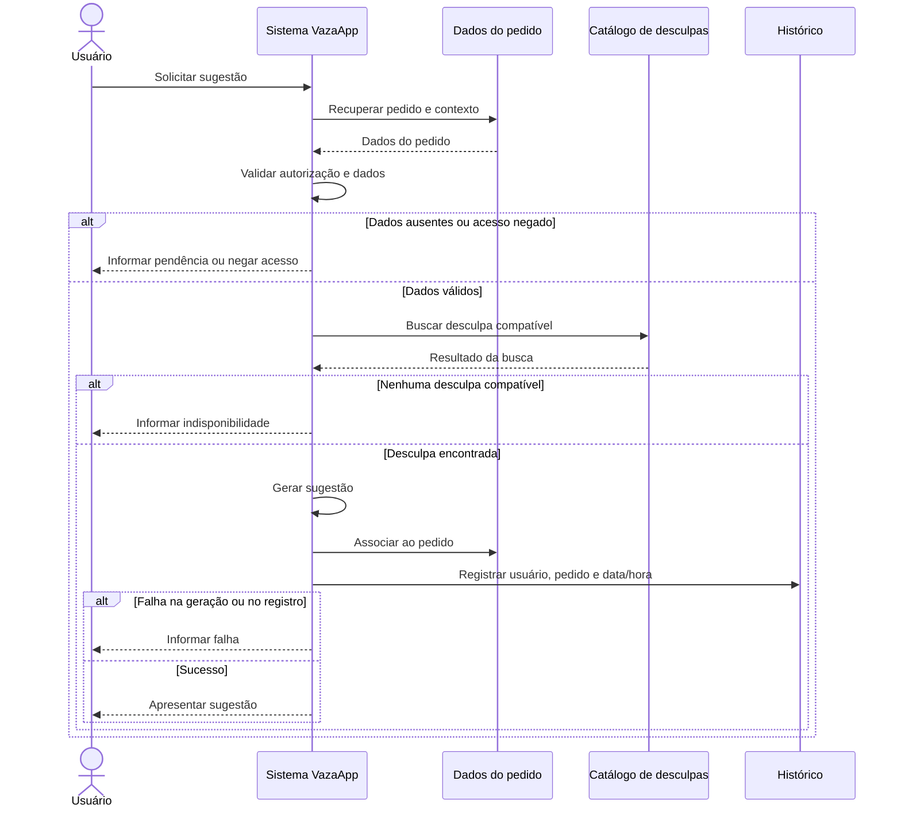

# Exercício 24 — Da análise ao projeto

**Projeto:** VazaApp  
**Caso de Uso:** UC-05 — Gerar sugestão personalizada

## 1. Regra de negócio e requisitos

- **RN-03:** exige contexto e informações do destinatário suficientes.
- **RN-04 e RN-05:** a sugestão deve considerar o contexto e uma categoria compatível.
- **RN-09:** registrar usuário, pedido e data/hora.
- **Requisitos:** RF-05 (validar dados), RF-06 (gerar sugestão), RF-07 (selecionar categoria) e RF-09 (registrar histórico).

## 2. Caso de Uso corrigido

**Ator:** Usuário autenticado.  
**Objetivo:** gerar uma sugestão de desculpa adequada à situação.  
**Gatilho:** usuário solicita uma sugestão para um pedido existente.  
**Pré-condições:** pedido criado, situação informada, contexto e destinatário disponíveis.

**Fluxo principal:**
1. O usuário solicita uma sugestão.
2. O sistema valida acesso e informações obrigatórias.
3. O sistema recupera o contexto e os dados do destinatário.
4. O sistema busca uma categoria e uma desculpa compatíveis.
5. O sistema gera a sugestão personalizada.
6. O sistema associa a sugestão ao pedido e registra o histórico.
7. O sistema apresenta a sugestão.

**Alternativos e exceções:**
- **Dados ausentes:** informar o que falta e interromper a geração.
- **Nenhuma desculpa compatível:** avisar o usuário.
- **Falha ao gerar, associar ou registrar:** informar que a operação não foi concluída e evitar dados inconsistentes.
- **Acesso não autorizado:** bloquear a operação.

## 3. Checklist e correções

| Problema | Correção |
|---|---|
| Dados obrigatórios pouco definidos | Especificar situação, contexto e destinatário necessários. |
| Falhas de associação e histórico pouco detalhadas | Definir o tratamento e impedir registros inconsistentes. |
| Privacidade pouco explícita | Verificar autorização antes de acessar os dados. |

## 4. Diagrama de sequência

**Justificativa dos elementos:**
- **Usuário:** inicia o caso de uso.
- **Sistema VazaApp:** valida dados e gera a sugestão.
- **Dados do pedido:** fornece contexto e recebe a associação da sugestão.
- **Catálogo:** permite selecionar uma desculpa compatível (RN-05/RF-07).
- **Histórico:** registra a sugestão (RN-09/RF-09).
- **Alternativas (`alt`):** representam dados ausentes, acesso negado, falta de sugestão e falhas.

## 5. Responsabilidades

| Elemento | Responsabilidade |
|---|---|
| Usuário | Solicitar sugestão e fornecer dados faltantes. |
| Sistema | Validar, aplicar regras e coordenar o fluxo. |
| Dados do pedido | Recuperar dados e associar a sugestão. |
| Catálogo | Buscar desculpas compatíveis. |
| Histórico | Registrar a sugestão concluída. |

**Resultado esperado:** sugestão personalizada apresentada e vinculada ao pedido, com registro no histórico.
