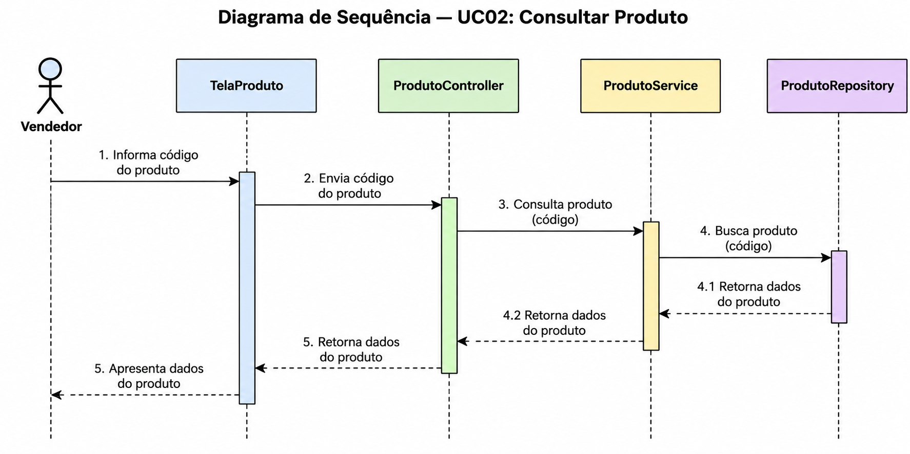
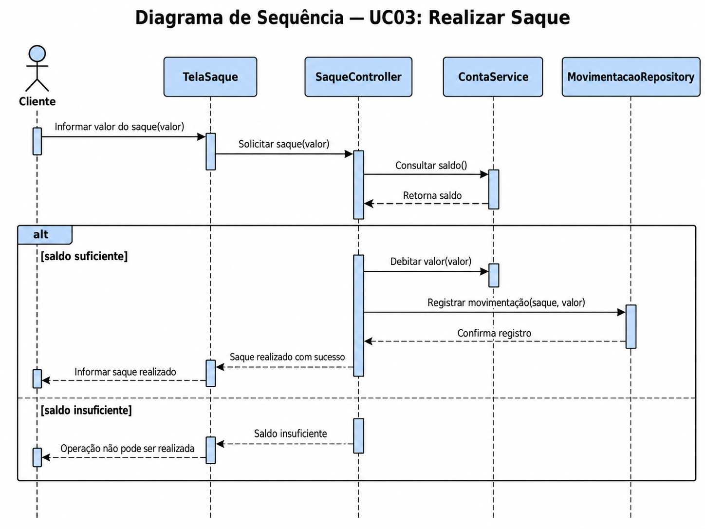
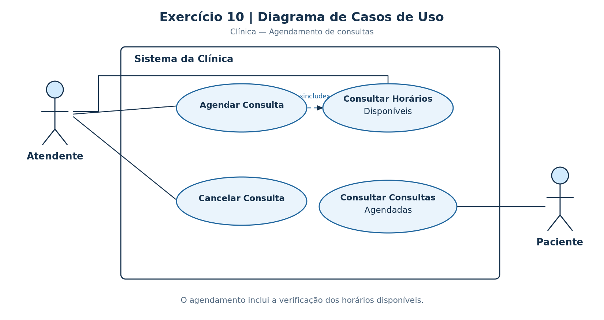
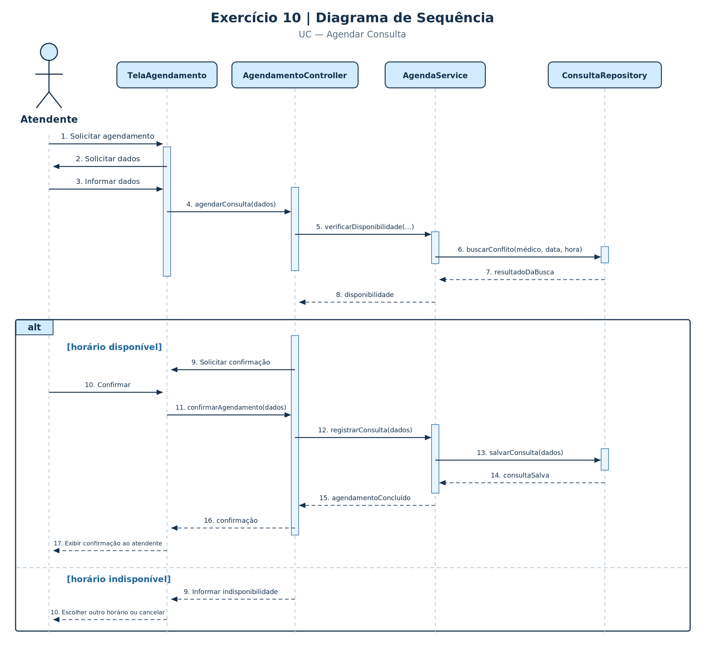

# Lista 05 --- Análise e projeto de Software

# Exercício 1 

Uma empresa desenvolve seus sistemas sem um processo definido. Cada
desenvolvedor conversa diretamente com o cliente, interpreta as
necessidades e implementa as funcionalidades da maneira que considera
mais adequada. Não existe documentação dos requisitos e poucas
funcionalidades possuem testes. Quando um desenvolvedor deixa a equipe,
parte do conhecimento sobre o sistema também é perdida.

Responda:

**a)** Quais problemas podem surgir devido a essa forma de
desenvolvimento?
R: perda e centralização do conhecimento, ficando concentrado na memória individual de cada dev; baixa qualidade e alto índice de falha sem uma estratégia estruturada de testes e arquitetura; dificuldade de manutenção e granularidade; a falta de formalização faz com q cada dev entenda de uma forma oq deve ser feito desalinhando expectativas e provavel retrabalho.

**b)** Explique o que é um **processo de desenvolvimento de software**.
R: É a aplicação de uma abordagem sistemática, disciplinada e mensurável para o desenvolvimento, a operação e a manutenção do software. Ele estabelece o conjunto de atividades, etapas, papéis/responsabilidades, artefatos e critérios de qualidade que orientam a equipe sobre o que fazer, quando fazer e como fazer, transformando necessidades do cliente em um produto de software funcional, confiável e sustentável.

**c)** Cite e explique pelo menos **quatro atividades** que poderiam
fazer parte do processo adotado pela empresa.
R: especificação de requisitos (elicitar, analisar, negociar, documentar e validar as necessidades do usuário durante o processo de construção), projeto e implementação (modelagem e arquitetura do sistema, onde coloca a mão na massa, estrutura dos dados, interfaces etc), validação (testes automatizados de qualidade para ver se cumpre os requisitos especificados) e evolução (com base nos testes, revisões e novas ncessidades, evolue o código para chegar ao ponto de entrega do software especificado)

**d)** Explique como essas atividades poderiam reduzir os problemas
apresentados no enunciado.
R: reduz diretamente os problemas da empresa ao substituir o desenvolvimento informal por um fluxo de trabalho estruturado e devidamente registrado. A atividade de especificação elimina a dependência da memória verbal dos desenvolvedores ao registrar de forma clara e perene. O projeto estabelece uma arquitetura padronizada para o sistema, permitindo que qualquer membro da equipe compreenda a estrutura do software e faça manutenções sem depender do criador original do código. A implementação orientada a padrões evita o desenvolvimento desorganizado e favorece o compartilhamento contínuo de conhecimento entre o time. Por fim, a validação por meio de testes garante a detecção precoce de falhas e funciona como uma documentação viva do sistema, permitindo que novos desenvolvedores compreendam o comportamento esperado da aplicação e realizem alterações com segurança

------------------------------------------------------------------------

# Exercício 2

Considere um sistema de locação de veículos.

Classifique cada afirmação como:

-   Regra de Negócio (RN);
-   Requisito Funcional (RF);
-   Requisito Não Funcional (RNF).

Justifique sua classificação.

**a)** Clientes com habilitação vencida não podem alugar veículos.
R: RN - é uma política e restrição do domínio sobre como a empresa opera, independe de um software

**b)** O sistema deve permitir que o atendente registre uma locação.
R: RF - descreve uma funcionalidade, serviço ou capacidade q o software deve oferecer para o usuário

**c)** Uma locação deve possuir período mínimo de uma diária.
R: RN - é uma condição/diretriz comercial q limita a operação do negócio, pertence as regras da locadora e existiria independemente do software adotado

**d)** O sistema deve apresentar os veículos disponíveis em até 3
segundos.
R: RNF - desempenho, é uma restrição de qualidade ou atributo mensurável sobre tempo de responda da funcionalidade de consulta

**e)** O sistema deve permitir registrar a devolução de um veículo.
R: RF - é um comportamente ativo ou serviço do software oferecido ao atendente para a conclusão do processo de locação

**f)** Clientes menores de 21 anos não podem alugar veículos da
categoria premium.
R: RN - é uma política da empresa baseada numa condição específica, definindo oq é permitido ou proibido no negócio

**g)** O sistema deve exigir autenticação dos funcionários.
R: RNF - segurança, estabelece uma restrição e um atributo de qualidade focado na proteção do acesso do software e segurança das operações da empresa

Depois responda:

> Qual é a principal diferença entre uma Regra de Negócio e um Requisito
> de Software?
R: RN pertence ao domínio do problema (políticas, normas, diretrizes, cálculos etc) e independe do software existindo mesmo sem qualquer sistema computadorizado. Já o RF pertence ao domínio da solução, especifica as funcionalidades do software, o que deve fazer e quais restrições tecnicas atender para garantir o cumprimentos das RN

------------------------------------------------------------------------

# Exercício 3

Considere o seguinte sistema:

> Uma academia permite que alunos agendem aulas coletivas. Cada aula
> possui um limite máximo de participantes. Um aluno não pode realizar
> duas reservas para aulas que ocorram no mesmo horário. Alunos com
> mensalidade vencida não podem realizar novos agendamentos. O sistema
> deve permitir que o aluno consulte as aulas disponíveis, realize uma
> reserva e cancele uma reserva. A consulta das aulas disponíveis deve
> apresentar o resultado em até dois segundos.

A partir da descrição:

**a)** Identifique as **Regras de Negócio** e numere-as como `RN01`,
`RN02` etc.
R:
RN01 - Limite de vagas, cada aula coletiva possui uma quant max de participantes q não pode ser ultrapassada
RN02 - Conflito de horário, um aluno n pode possuir duas ou mais reservas ativas no mesmo horário
RN03 - Mensalidade vencida, alunos com mensalidade vencida ficam bloqueados de realizar novos agendamentos de aulas

**b)** Identifique os **Requisitos Funcionais** e numere-os como `RF01`,
`RF02` etc.
R:
RF01 - Consultar aulas disponíveis, o sistema deve permitir q o aluno consulte e visualize suas aulas coletivas disponíveis
RF02 - Realizar uma reserva de aula, o sistema deve permitir q o aluno solicite a reserva de vaga em uma aula coletiva
RF03 - Cancelar uma reserva de aula, o sistema deve permitir q o aluno cancele uma reserva, desde que realizada previamente

**c)** Identifique os **Requisitos Não Funcionais**, classifique seu
tipo e justifique.
R:
RNF01 - Tempo de resposta da consulta (desempenho), a consulta das aulas disponíveis deve apresentar o resultado em até dois segundos, estabelecendo um critério quantitativo e mensurável de velocidade

**d)** Explique como uma Regra de Negócio pode influenciar um ou mais
Requisitos Funcionais.
R: A Regra de Negócio representa uma diretriz ou restrição do domínio da empresa e influencia o Requisito Funcional ao impor validações, condições e bloqueios aos fluxos do sistema. Ela determina como a funcionalidade deve se comportar diante de limitações do negócio, como impedir um agendamento caso haja pendências financeiras ou limite de vagas atingido

------------------------------------------------------------------------

# Exercício 4

Considere um sistema de biblioteca com as seguintes funcionalidades:

> Bibliotecários registram empréstimos e devoluções. Alunos consultam
> livros disponíveis e seu histórico de empréstimos. O coordenador da
> biblioteca pode cadastrar novos livros e bloquear usuários. O sistema
> também consulta um serviço externo de autenticação para validar o
> acesso dos usuários.

Responda:

**a)** Identifique os possíveis atores.
R: Bibliotecario - responsável pelos empréstimos e devoluções; Aluno - realiza consultas e acompanha sua situação na biblioteca; Coordenador da biblioteca - administrativo para gerenciar o acervo e os usuários; Serviço externo de autenticação - fornece serviço de validação de acesso ao software

**b)** Identifique os principais Casos de Uso.
R: 
UC01 - registrar empréstimos
UC02 - registrar devolução
UC03 - consultar livros disponíveis
UC04 - consultar histórico de empréstimos
UC05 - cadastrar novo livro
UC06 - bloquear usuário

**c)** Relacione cada ator aos Casos de Uso com os quais interage.
R: 
Bibliotecario: UC01 - Registrar Empréstimo e UC02 - Registrar Devolução
Aluno: UC03 - Consultar Livros Disponíveis e UC04 - Consultar Histórico de Empréstimos
Coordenador da biblioteca: UC05 - Cadastrar Novo Livro e UC06 - Bloquear Usuário
Serviço externo de autenticação: interage prestando suporte de validação aos fluxos que exigem autenticação do usuário

**d)** O serviço externo de autenticação pode ser considerado um ator?
Justifique.
R: Sim, um ator não se limita a seres humanos, é qualquer entidade externa à fronteira do sistema que interage com ele trocando informações. Como o serviço de autenticação é um software externo que responde a requisições de validação de acesso, ele é classificado como um ator secundário (ou de apoio).

**e)** Explique por que itens como **"clicar no botão Emprestar"**,
**"abrir a tela de livros"** e **"digitar matrícula"** normalmente não
devem ser modelados como Casos de Uso.
R: Pq esses itens como são apenas passos físicos de interação de interface, e não objetivos de negócio. O caso de uso deve representar uma sequencia de ações q entrega valor tangível para o ator.

------------------------------------------------------------------------

# Exercício 5

Considere:

``` text
UC01 — Fazer Reserva

Ator: Cliente

1. Cliente abre a tela.
2. Cliente escolhe.
3. Sistema verifica.
4. Cliente confirma.
5. Sistema salva.
6. Sistema finaliza.
```

Responda:

**a)** Identifique pelo menos **cinco problemas** nessa especificação.
R: 1. focada na GUI, descrevendo navegação física em vez de interação de negócio; 2. passos vagos e sem objeto, expressões escolhe e verifica não especificam sobre quais dados ou entidades operam; 3. ausencia de regras de negócio e validações durante o fluxo; 4. falta de retorno visual ao usuário encerrando o fluxo sem descrever a exibição de uma mensagem de confirmação; 5. ausencia de estrutura complementar do Caso de Uso (objetivo, pre e pós condições, fluxos alternativos e exceção)


**b)** Explique por que expressões como "sistema verifica", "sistema
salva" e "sistema finaliza" podem prejudicar a compreensão.
R: essas expressões genéricas não esclarecem o que esta sendo validado, e nem especificando quais dados estão sendo gravados nem o estado final da entidade no banco, gerando uma instrução vaga q não indica a resposta dada ao usuário ou o encerramento do processo do negócio

**c)** Quais elementos importantes de uma especificação de Caso de Uso
estão ausentes?
R: 
Objetivo: A meta concreta de negócio a ser alcançada pelo ator.
Pré-condições: As condições obrigatórias antes de iniciar o fluxo (ex.: Cliente autenticado no sistema).
Pós-condições: O estado garantido do sistema após o sucesso (ex.: Reserva gravada e vaga bloqueada).
Regras de Negócio (RNs) vinculadas: As políticas do domínio aplicadas em cada passo do fluxo.
Fluxos Alternativos (FA) e de Exceção (FE): O tratamento para caminhos secundários, erros e falhas de validação.

**d)** Reescreva o fluxo principal tornando as ações mais claras.
R: 
UC01 — Fazer Reserva
1. Cliente solicita a realização de uma reserva.
2. Sistema solicita os dados da reserva (data, horário e acomodação/serviço).
3. Cliente informa os dados solicitados.
4. Sistema valida a disponibilidade e a consistência dos dados.
5. Cliente confirma o agendamento da reserva.
6. Sistema persiste a reserva no banco de dados e bloqueia a vaga para o período escolhido.
7. Sistema exibe a mensagem de confirmação e o comprovante da reserva.

------------------------------------------------------------------------

# Exercício 6

Considere um sistema de hotel.

Regras de Negócio:

``` text
RN01 — Uma reserva somente pode ser realizada para um quarto disponível.

RN02 — A data de saída deve ser posterior à data de entrada.

RN03 — Um cliente não pode possuir duas reservas para o mesmo período.

RN04 — Reservas podem ser canceladas sem cobrança até 24 horas antes do check-in.
```

Requisito:

``` text
RF01 — O sistema deve permitir que o atendente registre reservas.
```

Elabore a especificação do:

``` text
UC01 — Registrar Reserva
```

A especificação deve conter:

-   objetivo;
-   ator principal;
-   pré-condições;
-   pós-condições;
-   fluxo principal;
-   pelo menos um fluxo alternativo;
-   pelo menos um fluxo de exceção;
-   Regras de Negócio relacionadas;
-   Requisitos relacionados.

R:
UC01 — Registrar Reserva

Objetivo: Registrar uma nova reserva de quarto de hotel solicitada por um cliente.
Ator Principal: Atendente.
Pré-condições: Atendente autenticado no sistema e Cliente previamente cadastrado no sistema.
Pós-condições: Reserva gravada com status "Confirmada"; Quarto bloqueado para o período selecionado e Comprovante e código de confirmação da reserva gerados.

Fluxo Principal:
1. Atendente solicita o registro de uma nova reserva.
2. Sistema solicita a identificação do cliente e as datas de entrada (check-in) e saída (check-out).
3. Atendente informa o cliente e o período desejado.
4. Sistema valida se a data de saída é posterior à data de entrada [RN02].
5. Sistema verifica se o cliente possui outra reserva ativa para o mesmo período [RN03].
6. Sistema apresenta as opções de quartos disponíveis para o período informado [RN01].
7. Atendente seleciona o quarto desejado e confirma a reserva.
8. Sistema persiste a reserva, bloqueia o quarto para o período e gera o código de confirmação [RN04].
9. Sistema exibe a mensagem de confirmação e disponibiliza o comprovante da reserva.

Fluxos Alternativos:
FA01 — Cliente Não Cadastrado (no passo 3):
  1. Atendente verifica que o cliente não possui cadastro no sistema.
  2. Atendente realiza o cadastro do novo cliente.
  3. Sistema grava o cadastro e retorna ao passo 3 do fluxo principal.

Fluxos de Exceção:
FE01 — Datas Inválidas (no passo 4):
  1. Sistema identifica que a data de saída é igual ou anterior à data de entrada [RN02].
  2. Sistema exibe mensagem de erro e solicita a correção das datas.

FE02 — Cliente com Reserva Conflitante (no passo 5):
  1. Sistema identifica que o cliente já possui reserva para o período informado [RN03].
  2. Sistema alerta a duplicidade de período e interrompe a reserva.

FE03 — Indisponibilidade de Quarto (no passo 6):
  1. Sistema identifica que não existem quartos disponíveis para o período solicitado [RN01].
  2. Sistema exibe alerta de indisponibilidade e permite alterar as datas ou cancelar a operação.

Regras de Negócio Relacionadas: RN01, RN02, RN03, RN04
Requisitos Relacionados: RF01

Ao final, explique:

> Como podemos verificar se o Caso de Uso está coerente com as Regras de
> Negócio?
R: A coerência é verificada vinculando cada Regra de Negócio ao ponto exato do Caso de Uso onde ela deve ser validada e garantindo que existam fluxos de exceção para tratar suas violações (matriz de rastreabilidade). Além disso, confirma-se que o fluxo principal não permite ações proibidas pelas regras do negócio e que os cenários de teste derivam diretamente dessas restrições.

------------------------------------------------------------------------

# Exercício 7

Considere um sistema de restaurante:

> O atendente pode registrar pedidos e cancelar pedidos. O cozinheiro
> pode consultar os pedidos que precisam ser preparados e marcar um
> pedido como pronto. O caixa pode registrar o pagamento. O gerente pode
> consultar relatórios de vendas.

**a)** Identifique os atores.
R: Atendente: responsável pela gestão dos pedidos; Cozinheiro: responsável pelo acopanhamento do preparo e finalização dos pratos; Caixa: responsável pelo recebimento financeiro; Gerente: responsável pela gestão do negócio e análise estratégica

**b)** Identifique os Casos de Uso.
R: 
UC01 - registrar pedidos
UC02 - cancelar pedidos
UC03 - consultar pedidos
UC04 - marcar pedido como pronto
UC05 - registrar pagamento
UC06 - consultar relatórios de vendas

**c)** Construa o **Diagrama de Casos de Uso**, representando as
associações entre atores e funcionalidades.
R:
Atendente -> UC01 e UC02
Cozinheiro -> UC03 e UC04
Caixa -> UC05
Gerente -> UC06

**d)** Explique o que representa a fronteira do sistema.
R: a fronteira do sistema (retangulo no diagrama) delimita o escopo do software, divide oq é interno e externo a ele

**e)** Explique a diferença entre:

``` text
ATOR - representa um papel externa q interage com o software para atingir uma meta (quem interage com o sistema)
```

e:

``` text
CASO DE USO - representa a sequencia de interações e comportamentos q o sistema realiza para entregar um resultado de valor (o que o sistema faz)
```


**f)** O Diagrama de Casos de Uso mostra a ordem em que as operações
acontecem? Justifique.
R: não, o diagrama de casos de uso é estático e declarativo, mostrando apenas quais atores tem permissça ou associação com quais uncionalidades, o encadeamento temporal das ações é definido na especificação textual do caso de uso e detalhado em diagramas de sequencia

------------------------------------------------------------------------

# Exercício 8

Considere o seguinte cenário:

``` text
UC02 — Consultar Produto

1. Vendedor informa o código do produto.
2. Sistema recebe o código.
3. Sistema consulta o produto.
4. Sistema obtém os dados do produto.
5. Sistema apresenta os dados ao vendedor.
```

Considere os participantes:

``` text
Vendedor
TelaProduto
ProdutoController
ProdutoService
ProdutoRepository
```

**a)** Construa um **Diagrama de Sequência** para o cenário.
R: 
INTERFACE
CONTROLE / APLICAÇÃO
DOMÍNIO
INFRAESTRUTURA

**b)** Indique qual participante deveria receber inicialmente a
interação do ator.
R: TelaProduto (interface), é o componente que interage diretamento com o ator (Vendedor), responsável por capturar os dados e apresentar o resultado final

**c)** Qual participante poderia ser responsável por coordenar a
operação?
R: ProdutoController (controle), atua como orquestrador do fluxo da aplicação, recebe as requiscições da camada da interface e direciona para os serviços

**d)** Qual participante seria responsável pela consulta/persistência
dos dados?
R: ProdutoRepository (persistencia), é o componente q tem acesso direto a base de dados para realizar a busca e recuperar registros

**e)** Explique por que a ordem vertical das mensagens é importante em
um Diagrama de Sequência.
R: Pq indica a passagem do tempo (linha do tempo avançando de cima para baixo), determinando a sequencia cronológica exata em q os eventos e chamadas de método acontecem, garantindo a dependencia temporal correta do fluxo

------------------------------------------------------------------------

# Exercício 9

Considere o Caso de Uso:

``` text
UC03 — Realizar Saque
```

Fluxo:

``` text
1. Cliente informa o valor do saque.
2. Sistema consulta o saldo da conta.
3. Sistema verifica se existe saldo suficiente.
4. Se houver saldo, o sistema realiza o débito.
5. Sistema registra a movimentação.
6. Sistema informa que o saque foi realizado.

Caso o saldo seja insuficiente:
7. Sistema informa que a operação não pode ser realizada.
```

Considere os participantes:

``` text
Cliente
TelaSaque
SaqueController
ContaService
MovimentacaoRepository
```

Construa um **Diagrama de Sequência** contendo:

-   ator;
-   participantes;
-   mensagens;
-   consulta/validação do saldo;
-   fragmento `alt`;
-   condição `[saldo suficiente]`;
-   condição `[saldo insuficiente]`;
-   registro da movimentação;
-   retorno do resultado ao cliente.

R: 


Depois explique:

> Qual é a finalidade do fragmento `alt` em um Diagrama de Sequência?
R: alt (alternative) é utilizado para modelar estruturas de decisão condicionais (estilo if/else), dividindo a execução do diagrama em dois ou mais blocos exclusivos, onde apenas um dos caminhos será executado no tempo de execução, dependendo do resultado da avaliação da condicação lógica de guarda

------------------------------------------------------------------------

# Exercício 10

Considere o seguinte problema:

> Uma clínica permite que pacientes agendem consultas. O paciente
> escolhe um médico, uma data e um horário. Um médico não pode possuir
> duas consultas no mesmo horário. Somente horários disponíveis podem
> ser agendados. O sistema deve permitir que o atendente registre
> consultas e cancelamentos. O paciente pode consultar suas consultas
> agendadas. A consulta dos horários disponíveis deve ser realizada em
> até dois segundos.

Realize as seguintes atividades:

## Parte A --- Regras e Requisitos

**a)** Identifique as Regras de Negócio.
R: 
RN01 - sem conflito de agenda, um médico n pode possuir duas ou mais consultas agendadas no msm horário
RN02 - horarios disponíveis, o agendamento de uma consulta é permitido apenas em horários livres

**b)** Identifique os Requisitos Funcionais.
R: 
RF01 - agendar consultas, o sistema deve permitir q o atendente registre o agendamento de consulta
RF02 - cancelar consulta, o sistema deve permitir q o atendente registre o cancelamento de consultas, desde q previamente agendadas
RF03 - consultar consultas agendadas, o sistema deve permitir q o paciente consulte suas consultas agendadas
RF04 - consultar horários disponíveis, o sistema deve permitir a consulta dos horários livres dos médicos

**c)** Identifique o Requisito Não Funcional e classifique-o.
R: 
RNF01 - tempo de resposta da consulta (desempenho), a consulta dos horários disponíveis deve ser realizada e exibida em até dois segundos

## Parte B --- Caso de Uso

Para:

``` text
UC — Agendar Consulta
```

defina:

-   ator principal;
-   objetivo;
-   pré-condições;
-   fluxo principal;
-   pelo menos um fluxo alternativo ou de exceção;
-   pós-condição.

R:
Ator Principal: Atendente.
Objetivo: Registrar uma nova consulta médica para um paciente em uma data e horário específicos.
Pré-condições: Atendente autenticado no sistema e Paciente e Médico previamente cadastrados.
Pós-condições: Consulta gravada com status "Agendada" e Horário bloqueado na agenda do médico.

Fluxo Principal:
1. Atendente solicita o agendamento de uma consulta.
2. Sistema solicita o paciente, médico, data e horário desejados.
3. Atendente informa os dados solicitados.
4. Sistema verifica se o horário está disponível e sem conflitos 
5. Atendente confirma a operação.
6. Sistema persiste o agendamento e bloqueia o horário.
7. Sistema exibe a mensagem de confirmação do agendamento.

Fluxo de Exceção (FE01 — Horário Indisponível)
1. No passo 4, se o sistema identificar que o horário está ocupado ou é inválido [RN01, RN02]:
2. Sistema exibe mensagem de alerta notificando a indisponibilidade.
3. Sistema solicita que o atendente escolha outro horário ou cancele a operação.

## Parte C --- Diagrama de Casos de Uso

Construa um Diagrama de Casos de Uso contendo os atores e
funcionalidades identificados.

R: 

## Parte D --- Diagrama de Sequência

Considere:

``` text
Atendente
TelaAgendamento
AgendamentoController
AgendaService
ConsultaRepository
```

Construa o Diagrama de Sequência para **Agendar Consulta**.

Utilize um fragmento `alt` para representar:

``` text
[horário disponível]

[horário indisponível]
```

R: 

## Parte E --- Integração dos conceitos

Explique a diferença de finalidade entre os seguintes artefatos:

``` text
REGRA DE NEGÓCIO
        ↓
REQUISITO
        ↓
CASO DE USO
        ↓
DIAGRAMA DE CASOS DE USO
        ↓
DIAGRAMA DE SEQUÊNCIA
```

Na resposta, explique **qual pergunta cada artefato ajuda a responder
durante a análise e o projeto do software**.

R: 
REGRA DE NEGÓCIO: Responde a "Quais são as políticas e restrições da organização?" — Define o que é permitido ou proibido no domínio do negócio, independentemente do software existir.
REQUISITO: Responde a "O que o sistema deve fazer e quais qualidades deve atender?" — Traduz as necessidades do negócio e dos usuários em capacidades funcionais e restrições de qualidade do software.
CASO DE USO: Responde a "Como o ator e o sistema interagem no tempo para atingir uma meta de negócio?" — Detalha a sequência temporal do diálogo, organizando o fluxo principal, desvios e exceções.
DIAGRAMA DE CASOS DE USO: Responde a "Quem são os atores e qual é o escopo/fronteira das funcionalidades do sistema?" — Oferece uma visão estática de alto nível sobre quem pode executar qual funcionalidade.
DIAGRAMA DE SEQUÊNCIA: Responde a "Como os componentes internos do software colaboram no tempo para realizar um cenário específico?" — Refina a arquitetura técnica, dividindo responsabilidades entre telas, controllers, serviços e banco de dados.