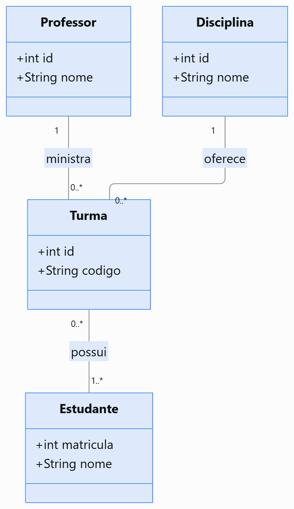
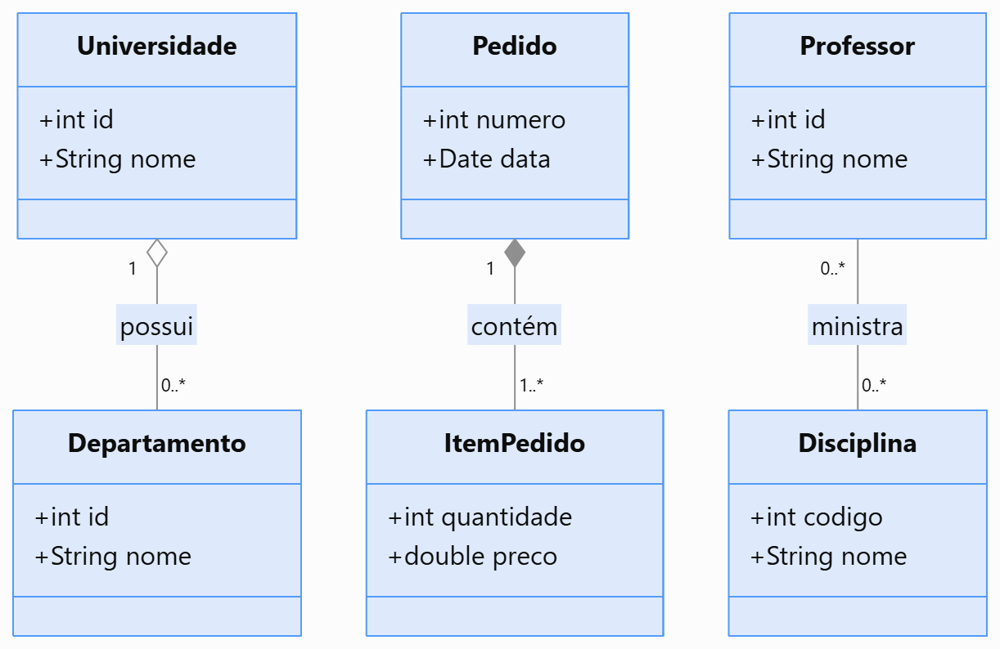
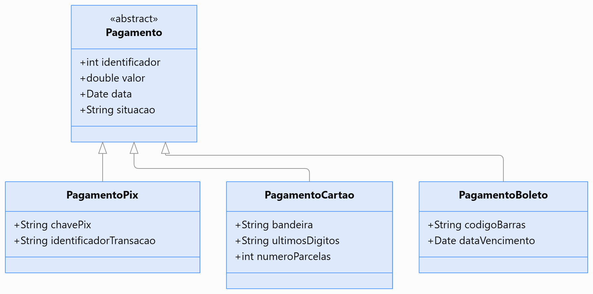
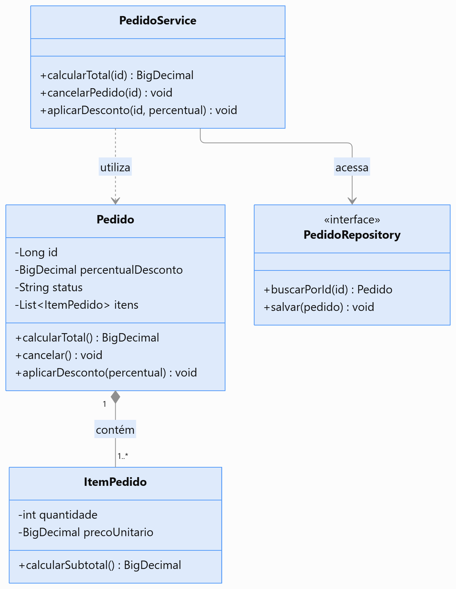
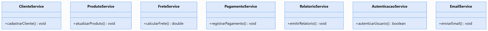
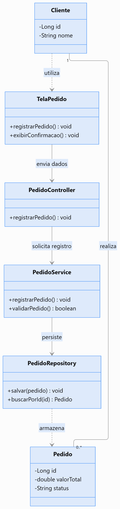

# Lista Master Class — Diagrama de Classes UML e Organização da Arquitetura de Software


## 1. Objetivo da atividade

Desenvolver a capacidade de transformar os artefatos produzidos durante a análise em uma proposta de estrutura e organização para implementação.

```text
REGRAS DE NEGÓCIO → REQUISITOS → CASOS DE USO
→ DIAGRAMA DE SEQUÊNCIA → IDENTIFICAÇÃO DE CLASSES
→ DEFINIÇÃO DE RESPONSABILIDADES → DIAGRAMA DE CLASSES
→ ORGANIZAÇÃO DA ARQUITETURA → ESTRUTURA DE DIRETÓRIOS
→ IMPLEMENTAÇÃO
```

**Objetivo central:** compreender como as decisões de análise e projeto orientam a identificação das classes, a distribuição de responsabilidades e a organização do código-fonte.

---

# Parte 1 — Fundamentos da modelagem estrutural

## Exercício 1 — Modelagem comportamental × estrutural

Uma equipe produziu um Diagrama de Casos de Uso e um Diagrama de Sequência. Um desenvolvedor afirmou:

> "Já sabemos quais funcionalidades o sistema possui e como os objetos interagem. Portanto, não precisamos de um Diagrama de Classes."

Responda:

a) Qual é a finalidade do Diagrama de Casos de Uso?  
R: Oferecer uma visão geral do escopo funcional e dos limites do sistema a partir da perspectiva dos atores externos
. Ele responde a "QUEM interage com o sistema e QUAIS metas de negócio os atores desejam alcançar"

b) Qual é a finalidade do Diagrama de Sequência?  
R: Representar a dinâmica e a ordenação temporal das mensagens trocadas entre os componentes/objetos para realizar um cenário específico de um Caso de Uso
. Ele foca no aspecto comportamental temporal (COMO e em qual ordem cronológica os participantes colaboram)

c) Qual é a finalidade do Diagrama de Classes?  
R: Apresentar a estrutura estática do software
. Ele define as entidades permanentes (classes, seus atributos, operações e visibilidades) e como elas se relacionam estaticamente (associações, multiplicidades, agregação, composição, herança e dependências) para guiar a implementação da arquitetura

d) Quais informações estruturais não são necessariamente apresentadas em um Diagrama de Sequência?  
R: 
- Tipagem e lista completa de atributos das entidades
- Relacionamentos estáticos e suas multiplicidades (ex.: 1..*, 0..1)
- Tipos de acoplamento estático (herança/generalização, composições e agregações)
- Modificadores de visibilidade (+ público, - privado, # protegido)
- Métodos e atributos que não participam daquela interação específica

e) Explique como os três diagramas podem se complementar.
R: 
Casos de Uso (Visão Externa / Requisitos): Define O QUE o sistema deve fazer e delimita a fronteira do problema;
Diagrama de Sequência (Visão Comportamental / Dinâmica): Refina os cenários do Caso de Uso, descobrindo COMO os objetos trocam mensagens ao longo do tempo para realizar cada fluxo;
Diagrama de Classes (Visão Estrutural / Estática): Consolida os objetos descobertos na sequência em estruturas definitivas de código, mapeando atributos, assinaturas de métodos e relacionamentos permanentes que orientam a codificação;

## Exercício 2 — Identificação de classes

> Uma biblioteca possui livros, exemplares físicos, alunos e empréstimos. Um livro pode possuir vários exemplares. Um aluno pode realizar vários empréstimos, mas cada empréstimo pertence a um único aluno e está associado a um exemplar. O sistema registra a data do empréstimo, a data prevista de devolução e a data efetiva da devolução.

Identifique: (1) possíveis classes do domínio; (2) atributos; (3) operações; (4) relacionamentos.

| Classe | Atributos | Operações | Responsabilidade |
|---|---|---|---|
| **Livro** | `isbn: String`<br>`titulo: String`<br>`autor: String` | `cadastrarExemplar()`<br>`obterQtdExemplares()` | Representar a obra conceitual e abstrata registrada no acervo. |
| **Exemplar** | `codigoTombo: String`<br>`status: String` | `marcarComoEmprestado()`<br>`marcarComoDisponivel()`<br>`verificarDisponibilidade(): Boolean` | Representar a unidade física concreta do livro disponível para empréstimo. |
| **Aluno** | `matricula: String`<br>`nome: String`<br>`statusAtivo: Boolean` | `verificarPendencias(): Boolean`<br>`podeEmprestar(): Boolean` | Representar o estudante que solicita os empréstimos e suas restrições. |

R:
- Livro 1 ──* Exemplar: Associação/Composição (1 título possui $1..N$ exemplares físicos).
- Aluno 1 ──* Emprestimo: Associação (1 Aluno possui $0..N$ Empréstimos; cada Empréstimo pertence a $1$ Aluno).
- Emprestimo * ── 1 Exemplar: Associação (Cada Empréstimo está associado a exatamente $1$ Exemplar).

**Discussão:** todo substantivo encontrado na descrição deve necessariamente se transformar em classe? Justifique.

R: 
Não. Nem todo substantivo se torna uma classe:
Substantivos podem ser atributos de uma classe existente (ex.: "data do empréstimo", "data prevista" e "data efetiva" são substantivos no texto, mas representam atributos da classe Emprestimo).
Substantivos podem ser tipos/valores primitivos (ex.: "código", "nome", "matrícula").
Substantivos podem referir-se ao próprio sistema ou atores externos.
Uma entidade só deve ser modelada como classe se possuir identidade própria, estado (múltiplos atributos) e comportamento (operações) no domínio.

## Exercício 3 — Anatomia de uma classe UML

```text
+-------------------------------------+
|               Produto               |
+-------------------------------------+
| - id: Long                          |
| - nome: String                      |
| - preco: Decimal                    |
| - quantidade: Integer               |
+-------------------------------------+
| + calcularSubtotal(qtd): Decimal    |
| + verificarEstoque(qtd): Boolean    |
| + atualizarPreco(valor): void       |
+-------------------------------------+
```

Responda:

a) O que representam os três compartimentos?  
R: 
Superior: Nome da classe (Produto).
Central: Atributos (estado/propriedades da classe).
Inferior: Operações/Métodos (comportamentos e funções da classe).

b) Qual é a diferença entre atributos e operações?  
R:
Atributos: Representam os dados e o estado estático armazenados pelo objeto.
Operações: Representam os comportamentos, ações e lógica executável que a classe disponibiliza.

c) O que significam `+` e `-`?  
R:
(Hífen): Visibilidade Privada (private). O membro é acessível apenas internamente dentro da própria classe
(Sinal de mais): Visibilidade Pública (public). O membro é acessível por qualquer objeto externo

d) O que representa o tipo após os dois-pontos?  
R:
Para atributos (ex.: preco: Decimal): Define o tipo de dado do campo
Para operações (ex.: calcularSubtotal(qtd): Decimal): Define o tipo de retorno retornado pela função após a execução (ex.: Decimal, Boolean, void)

e) Por que documentar operações, e não apenas atributos?  
R: Porque as operações definem o contrato de serviço e a interface pública da classe. Em Orientação a Objetos, a comunicação ocorre por envio de mensagens (chamadas de métodos). Se documentássemos apenas atributos, a classe seria uma estrutura passiva de dados (modelo anêmico), sem regras de comportamento ou encapsulamento expressos.

f) Explique a relação entre visibilidade e encapsulamento.
R: O encapsulamento é o princípio de ocultar os detalhes internos de implementação e proteger o estado direto de um objeto. A visibilidade é o mecanismo gráfico/sintático que materializa o encapsulamento: ao definir atributos como privados (-), impede-se que terceiros alterem dados indevidamente; ao definir operações como públicas (+), expõem-se métodos seguros e validados para interação

---

# Parte 2 — Relacionamentos entre classes

## Exercício 4 — Associação e multiplicidade

Considere um sistema acadêmico:

- Um professor pode ministrar várias turmas.
- Cada turma possui um professor responsável.
- Uma turma possui vários estudantes.
- Um estudante pode participar de várias turmas.
- Cada turma pertence a uma disciplina.
- Uma disciplina pode ser oferecida em várias turmas.

Construa um Diagrama de Classes com `Professor`, `Turma`, `Estudante` e `Disciplina`, incluindo relacionamentos e multiplicidades.
R: 

Explique o significado de `1`, `0..1`, `0..*` e `1..*` e a importância das multiplicidades para a implementação.
R: No Código: Orientam a escolha dos tipos de atributos. Relacionamentos 1 tornam-se referências diretas a objetos, enquanto 0..* ou 1..* tornam-se coleções (List, Set). No Banco de Dados: Definem a presença de chaves estrangeiras (FK) e a criação de tabelas intermediárias (para relacionamentos N..N, como entre Turma e Estudante). Nas Regras de Negócio: Guiam as validações de integridade (ex.: impedir o cadastro de uma Turma sem uma Disciplina pai vinculada).
1: Exatamente um (obrigatório).
0..1: Zero ou um (opcional).
0..* (ou *): Zero ou muitos (coleção opcional).
1..*: Um ou muitos (pelo menos um é obrigatório).

## Exercício 5 — Associação, agregação e composição

**Cenário A:** uma universidade possui departamentos. Um departamento pode continuar existindo mesmo que seja transferido para outra universidade.

**Cenário B:** um pedido possui itens. Cada item pertence exclusivamente àquele pedido e não possui significado independente dele.

**Cenário C:** um professor ministra disciplinas.

Responda:

a) Qual relacionamento é mais adequado em cada cenário?  
R:
Cenário A (Universidade e Departamento): Agregação (o--). O departamento é parte da universidade, mas possui vida própria e pode ser transferido.
Cenário B (Pedido e ItemPedido): Composição (*--). O item depende estritamente da existência do pedido pai.
Cenário C (Professor e Disciplina): Associação simples (--). Trata-se de um vínculo de trabalho/atribuição sem relação de todo/parte.

b) Diferencie associação, agregação e composição.  
R:
Associação: Relacionamento estrutural simples entre classes independentes que colaboram entre si (relação de uso).
Agregação: Tipo de associação que representa uma relação "todo/parte" fraca. Os objetos partes podem existir independentemente do objeto todo.
Composição: Tipo de associação que representa uma relação "todo/parte" forte. A parte pertence exclusivamente ao todo e compartilha o mesmo ciclo de vida.

c) O que ocorre com as partes de uma composição quando o objeto composto deixa de existir? 
R: As partes são destruídas automaticamente junto com o objeto pai, pois não possuem identidade ou utilidade autônoma fora do contexto do todo (ex.: ao cancelar um Pedido, seus Itens são excluídos).

d) Por que não usar composição apenas porque uma classe referencia outra?
R: Porque uma simples referência não implica posse exclusiva nem dependência de ciclo de vida. Usar composição indevidamente cria acoplamento rígido desnecessário, impedindo que o objeto referenciado seja compartilhado com outras partes do sistema (ex.: um Cliente é referenciado no Pedido, mas não deve ser destruído se o pedido for cancelado).

Construa um pequeno Diagrama de Classes para os três cenários. Justifique com base em identidade, propriedade e ciclo de vida dos objetos.
R: 

Universidade "1" o-- "0..*" Departamento : Agregação
Pedido "1" *-- "1..*" ItemPedido : Composição
Professor "*" -- "*" Disciplina : Associação

## Exercício 6 — Herança e generalização

Considere `Pagamento`, `PagamentoPix`, `PagamentoCartao` e `PagamentoBoleto`. Todos possuem identificador, valor, data e situação, mas cada modalidade possui características próprias.

Responda:

a) Quais atributos pertencem à superclasse (Pagamento)?  
R: 
id: Long
valor: Decimal
data: Date
situacao: String

b) Quais comportamentos podem ser compartilhados?  
R:
processarPagamento()
cancelarPagamento()
consultarStatus()

c) Quais são específicos?  
R:
PagamentoPix: Atributos chavePix, qrCode | Comportamento gerarQrCode().
PagamentoCartao: Atributos numeroCartao, bandeira, parcelas | Comportamento autorizarOperadora().
PagamentoBoleto: Atributos codigoBarras, dataVencimento | Comportamento gerarLinhaDigitavel().

d) Construa o diagrama com generalização.  
R: 

e) Diferencie herança e composição.  
R: 
Herança (Relação "É UM"): Cria uma hierarquia estática em tempo de compilação onde a subclasse herda a estrutura da superclasse.
Composição (Relação "TEM UM"): Cria uma relação dinâmica onde uma classe inclui instâncias de outra para delegar comportamentos, sendo mais flexível.

f) Quando a herança pode prejudicar a evolução?
R: A herança prejudica a evolução quando é aplicada indevidamente apenas para reaproveitamento de código sem que exista uma relação conceitual de especialização (problema da classe base frágil). Nesses casos, qualquer mudança na superclasse pode impactar ou quebrar involuntariamente o comportamento de diversas subclasses cascata abaixo.

---

# Parte 3 — Responsabilidades e qualidade do projeto

## Exercício 7 — Classes anêmicas e responsabilidades

```java
public class Pedido {
    private Long id;
    private double valorTotal;
    private String status;
    // getters e setters
}
```

```java
public class PedidoService {
    public double calcularTotal(Pedido pedido) { /* ... */ }
    public void cancelarPedido(Pedido pedido) { /* ... */ }
    public void aplicarDesconto(Pedido pedido) { /* ... */ }
}
```

Responda:

a) Qual é a responsabilidade de `Pedido`?  
R: Na estrutura apresentada, a classe Pedido atua apenas como uma estrutura passiva de dados (Modelo Anêmico). Sua única responsabilidade é armazenar valores e expô-los via getters e setters, sem conter qualquer regra de negócio.

b) Qual é a de `PedidoService`?  
R: PedidoService assume toda a lógica de negócio e manipulação do estado de Pedido. Ela decide como calcular totais, validar regras e alterar o status do pedido.

c) Quais operações podem ser comportamentos próprios do domínio `Pedido`?  
R: 
calcularTotal(): double
cancelar(): void
aplicarDesconto(double percentual): void

d) Por que concentrar todas as regras em uma única `Service` pode ser problemático?  
R: Violação do Encapsulamento: Expõe os atributos internos da entidade via setters públicos, permitindo alterações indevidas por qualquer parte do sistema. Baixa Coesão no Service: A classe Service tende a crescer descontroladamente (God Class), acumulando responsabilidades heterogêneas. Violacão do Padrão GRASP Especialista na Informação (Information Expert): A entidade que possui os dados (Pedido) não é a mesma que executa a lógica sobre eles.

e) Proponha uma distribuição de responsabilidades e represente-a em UML.
R: Entidade Pedido (Domínio): Responsável por manter a consistência de seu próprio estado (calcularTotal(), aplicarDesconto(), cancelar()) e PedidoService (Serviço de Aplicação): Responsável por orquestrar o caso de uso (buscar o pedido no repositório, invocar os métodos do domínio e salvar o resultado).


**Importante:** nem toda regra precisa estar em uma entidade; considere serviços de domínio e de aplicação quando apropriado.

## Exercício 8 — Coesão e acoplamento

```text
SistemaManager
    cadastrarCliente()
    atualizarProduto()
    calcularFrete()
    registrarPagamento()
    emitirRelatorio()
    autenticarUsuario()
    enviarEmail()
```

Responda:

a) Qual problema de projeto a classe apresenta?  
R: A classe é uma "God Class" (Classe Deus). Ela acumula múltiplas responsabilidades não correlacionadas, violando o Princípio da Responsabilidade Única (SRP) do SOLID.

b) Explique coesão.  
R: Coesão é o grau de afinidade entre os atributos e métodos de uma mesma classe. Alta coesão indica que a classe tem um propósito único, claro e bem delimitado.

c) Explique acoplamento.  
R: Acoplamento é o nível de dependência entre classes distintas. Baixo acoplamento significa que alterações em uma classe causam pouco ou nenhum impacto nas demais.

d) Como responsabilidades mal distribuídas afetam manutenção e testes?  
R:
Manutenção: Torna o código frágil e propenso a regressões; alterar uma regra de frete pode acidentalmente quebrar o envio de e-mails.
Testes: Torna os testes unitários extremamente complexos, pois exige a criação de mocks pesados para dependências não relacionadas ao teste em questão.

e) Reorganize as operações em classes específicas.  
R:
ClienteService: cadastrarCliente()
ProdutoService: atualizarProduto()
FreteService: calcularFrete()
PagamentoService: registrarPagamento()
RelatorioService: emitirRelatorio()
AutenticacaoService: autenticarUsuario()
EmailService: enviarEmail()

f) Construa um Diagrama de Classes da nova organização.
R: 

## Exercício 9 — Da sequência para as classes

```text
Cliente → TelaPedido → PedidoController → PedidoService → PedidoRepository
```

O sistema deve registrar pedidos.

Responda:

a) Quais participantes poderiam virar classes concretas?  
R: TelaPedido, PedidoController, PedidoService e PedidoRepository, além das entidades de domínio associadas, como Pedido e ItemPedido.

b) Quais responsabilidades pertencem à interface, aplicação, domínio ou infraestrutura?
R: 
Interface (UI / Boundary): TelaPedido — Interação gráfica e captura de dados do usuário.
Aplicação (Controller): PedidoController — Recebimento da requisição HTTP/UI e delegação para a camada de negócio.
Domínio (Service / Entity): PedidoService e Pedido — Execução e validação das regras de negócio do sistema.
Infraestrutura (Repository): PedidoRepository — Persistência e comunicação direta com o banco de dados.

c) Quais operações podem ser identificadas a partir das mensagens?  
R: 
TelaPedido: solicitarCriacaoPedido(), exibirConfirmacao()
PedidoController: registrarPedido(dto)
PedidoService: processarPedido(pedido), validarEstoque()
PedidoRepository: salvar(pedido), buscarPorId(id)

d) O Diagrama de Sequência permite descobrir atributos? Explique.  
R: 
Sim. Ao analisar as mensagens trocadas, os parâmetros enviados (ex.: codigoProduto, quantidade, cpfCliente) e os retornos obtidos revelam os dados necessários para compor os atributos das classes envolvidas.

e) Construa um Diagrama de Classes para o cenário.  
R: 

f) Por que nem todo participante da sequência aparece no Diagrama de Classes de domínio?
R: Porque o Diagrama de Classes de Domínio representa estritamente os conceitos e regras de negócio permanentes da organização (Pedido, Cliente, Produto). Participantes como telas (TelaPedido), controladores (PedidoController) e repositórios (PedidoRepository) pertencem às camadas técnicas de Apresentação, Aplicação e Infraestrutura, figurando apenas no Diagrama de Classes de Projeto/Arquitetura.

---

# Parte 4 — Arquitetura de software

## Exercício 10 — Organização em camadas

Classifique as responsabilidades em **Apresentação/Interface**, **Aplicação**, **Domínio** ou **Infraestrutura**:

1. Receber requisições HTTP.
2. Validar regras de negócio.
3. Coordenar a execução de um Caso de Uso.
4. Consultar registros no banco de dados.
5. Representar uma entidade do domínio.
6. Converter dados recebidos em objetos.
7. Persistir alterações.
8. Retornar uma resposta HTTP.

Responda:

a) Qual a finalidade de cada camada?  
b) Quais classes poderiam existir em cada uma?  
c) Diferencie camada lógica e diretório físico.  
d) A arquitetura exige quatro diretórios?  
e) Como a separação ajuda a manutenção?

## Exercício 11 — Controller, Service, Entity e Repository

Considere `ProdutoController`, `ProdutoService`, `Produto` e `ProdutoRepository`.

Responda:

a) Responsabilidade de cada classe.  
b) Quem recebe a requisição HTTP?  
c) Quem coordena o Caso de Uso?  
d) Quem representa conceitos e comportamentos do domínio?  
e) Quem oferece acesso aos dados?  
f) Por que a entidade não deveria depender do controlador HTTP?  
g) Construa um Diagrama de Classes com dependências relevantes.

**Atenção:** diferencie o contrato de repositório de sua implementação concreta na infraestrutura.

## Exercício 12 — Dependências inadequadas

```text
ProdutoController → ProdutoRepository → Banco de Dados
```

O controlador também calcula descontos, valida estoque e determina regras de preço.

Responda:

a) Quais problemas existem?  
b) Acesso direto ao repositório pelo controlador é sempre incorreto? Justifique.  
c) Como reorganizar a arquitetura?  
d) O que pertence ao domínio?  
e) O que pertence à aplicação?  
f) Construa um Diagrama de Classes da solução.

---

# Parte 5 — Organização de diretórios e documentação

## Exercício 13 — Estrutura de diretórios

Uma equipe iniciou o projeto assim:

```text
src/main/java/sistema/
├── Cliente.java
├── Produto.java
├── Pedido.java
├── ClienteController.java
├── ProdutoController.java
├── PedidoController.java
├── ClienteService.java
├── ProdutoService.java
├── PedidoService.java
├── ClienteRepository.java
├── ProdutoRepository.java
└── PedidoRepository.java
```

Responda:

a) Quais dificuldades surgem com o crescimento?  
b) Proponha organização por camadas.  
c) Proponha organização por funcionalidades/módulos.  
d) Compare as propostas.  
e) Qual facilita localizar tudo relacionado a `Registrar Pedido`?  
f) Justifique a escolha para um sistema médio.

## Exercício 14 — Organização por camadas × funcionalidades

### Estrutura A — Por camadas

```text
src/main/java/br/edu/sistema/
├── controller/
│   ├── ClienteController.java
│   └── PedidoController.java
├── service/
│   ├── ClienteService.java
│   └── PedidoService.java
├── repository/
│   ├── ClienteRepository.java
│   └── PedidoRepository.java
└── model/
    ├── Cliente.java
    └── Pedido.java
```

### Estrutura B — Por funcionalidades

```text
src/main/java/br/edu/sistema/
├── cliente/
│   ├── Cliente.java
│   ├── ClienteController.java
│   ├── ClienteService.java
│   └── ClienteRepository.java
└── pedido/
    ├── Pedido.java
    ├── PedidoController.java
    ├── PedidoService.java
    └── PedidoRepository.java
```

Responda:

a) Qual o critério de cada organização?  
b) Vantagens e desvantagens?  
c) Como afetam a compreensão da arquitetura?  
d) Diretórios garantem boa arquitetura?  
e) Como combinar módulos por funcionalidade com responsabilidades internas?

## Exercício 15 — Documentação das classes

```java
public class PedidoService {
    public void registrarPedido(Pedido pedido) { /* ... */ }
}
```

Documente nome, responsabilidade, operações públicas, parâmetros, resultados esperados, dependências, RN, RF e UC relacionados.

| Campo | Descrição |
|---|---|
| Classe | |
| Responsabilidade | |
| Operações | |
| Dependências | |
| RN relacionadas | |
| RF relacionadas | |
| UC relacionados | |

**Discussão:** qual a diferença entre documentar uma classe e documentar um Caso de Uso?

---

# Parte 6 — Integração entre análise, projeto e arquitetura

## Exercício 16 — Rastreabilidade até as classes

```text
RN01 — Um pedido não pode ser confirmado quando algum produto estiver indisponível.
RF01 — O sistema deve permitir registrar pedidos.
UC01 — Registrar Pedido.
```

Construa:

```text
RN01 → RF01 → UC01 → DIAGRAMA DE SEQUÊNCIA
→ CLASSES E OPERAÇÕES → MÓDULOS/DIRETÓRIOS
```

Responda:

a) Quais classes são necessárias?  
b) Quem verifica disponibilidade?  
c) Quem confirma o pedido?  
d) Como a RN01 aparece na sequência?  
e) Como documentar a relação entre RN01 e as classes?

## Exercício 17 — Arquitetura de um sistema de estoque

Funcionalidades: cadastrar produtos; registrar entrada e saída de mercadorias; consultar estoque; emitir relatório de movimentações.

```text
RN01 — O estoque não pode ficar negativo.
RN02 — Toda entrada deve gerar uma movimentação.
RN03 — Toda saída deve gerar uma movimentação.
RN04 — Somente usuários autorizados podem registrar movimentações.
```

Realize:

a) Identifique classes do domínio.  
b) Defina atributos e operações.  
c) Identifique associações e multiplicidades.  
d) Construa Diagrama de Classes do domínio.  
e) Identifique componentes de aplicação.  
f) Identifique infraestrutura.  
g) Proponha diretórios.  
h) Explique onde cada RN é aplicada.

---

# Parte 7 — Master Class: projeto completo

## Exercício 18 — Do Caso de Uso à arquitetura

### Sistema de Gerenciamento de Pedidos

Uma empresa deseja gerenciar clientes, produtos e pedidos. O sistema deve permitir cadastrar clientes e produtos, consultar produtos, registrar pedidos, adicionar produtos, calcular total, confirmar e cancelar pedidos e consultar histórico.

### Regras de Negócio

**RN01:** Um pedido deve estar associado a um cliente.  
**RN02:** Um pedido deve possuir pelo menos um item para ser confirmado.  
**RN03:** Produtos sem estoque suficiente não podem ser adicionados ao pedido.  
**RN04:** O total corresponde à soma dos subtotais, considerando descontos autorizados.  
**RN05:** Pedidos confirmados não podem ter seus itens alterados.  
**RN06:** Somente pedidos ainda não enviados podem ser cancelados.

### Etapa 1 — Análise

Identifique requisitos funcionais, requisitos não funcionais relevantes, atores e Casos de Uso.

### Etapa 2 — Especificação

Especifique `UC01 — Registrar Pedido` com objetivo, ator, pré-condições, pós-condições, fluxo principal, alternativas, exceções, RN e RF relacionados.

### Etapa 3 — Diagrama de Sequência

Modele o registro de pedido com `Vendedor`, `TelaPedido`, `PedidoController`, `PedidoService`, `EstoqueService` e `PedidoRepository` (ajuste participantes se necessário). Use `alt` para disponibilidade, `loop` para vários produtos e mensagens de confirmação e persistência.

### Etapa 4 — Identificação das classes

Identifique classes do domínio, aplicação, interfaces e infraestrutura.

| Classe | Responsabilidade | Atributos | Operações |
|---|---|---|---|
| | | | |
| | | | |

### Etapa 5 — Diagrama de Classes

Represente classes, atributos, operações, visibilidade, relacionamentos, multiplicidades e dependências relevantes.

### Etapa 6 — Arquitetura

Organize as responsabilidades em **Apresentação**, **Aplicação**, **Domínio** e **Infraestrutura**. Defina classes, dependências permitidas e dependências a evitar. Explique que a divisão em camadas não impõe necessariamente dependências unidirecionais entre todas elas.

### Etapa 7 — Estrutura de diretórios

Complete a proposta Java:

```text
src/main/java/br/edu/sistema/
├── cliente/
├── produto/
└── pedido/
```

Identifique classes, interfaces, serviços, controladores, repositórios e DTOs quando necessários.

### Etapa 8 — Documentação arquitetural

Produza documento com:

1. Visão geral do sistema.
2. Decisões arquiteturais e justificativas.
3. Árvore de diretórios comentada.
4. Responsabilidades das principais classes.
5. Diagramas de Classes e Sequência.
6. Rastreabilidade RN–RF–UC–classes.
7. Regras de dependência entre módulos.

---