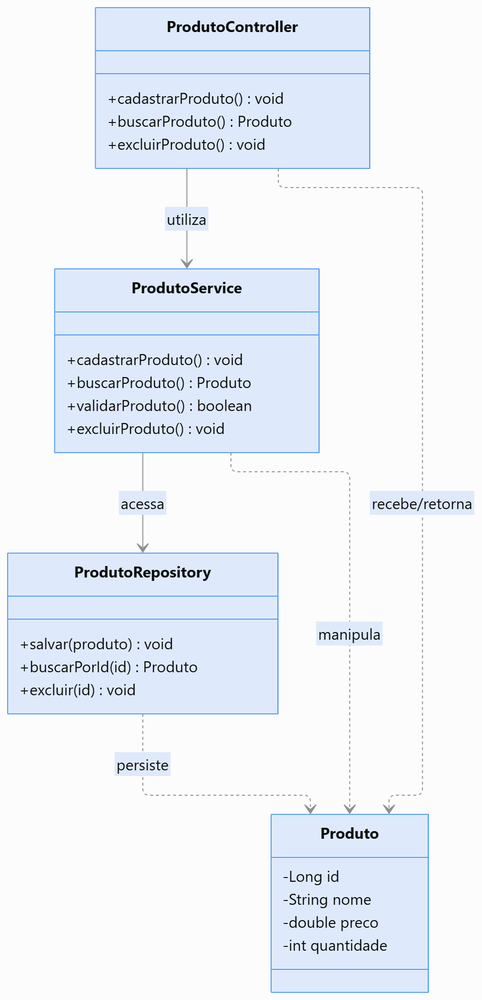
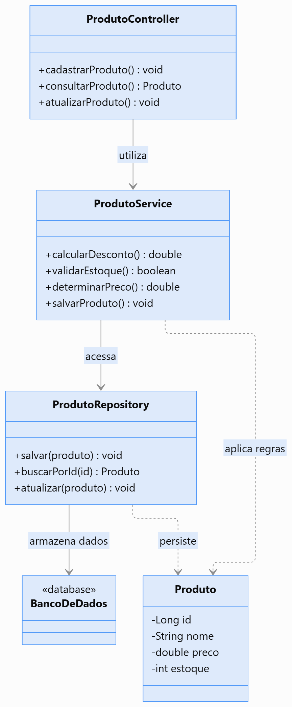
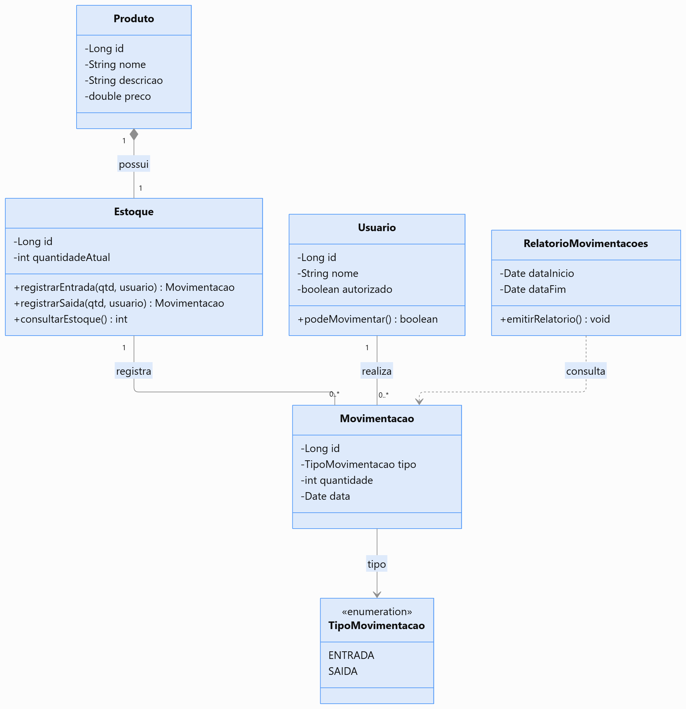
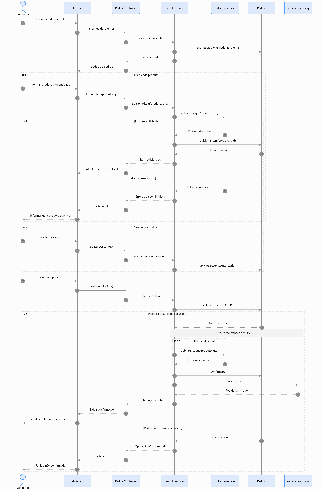
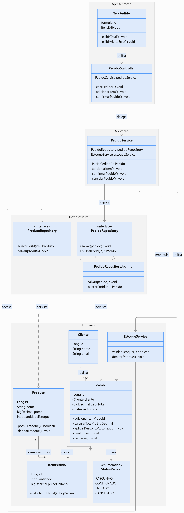

# Lista Master Class — Diagrama de Classes UML e Organização da Arquitetura de Software


## 1. Objetivo da atividade

Desenvolver a capacidade de transformar os artefatos produzidos durante a análise em uma proposta de estrutura e organização para implementação.

```text
REGRAS DE NEGÓCIO → REQUISITOS → CASOS DE USO
→ DIAGRAMA DE SEQUÊNCIA → IDENTIFICAÇÃO DE CLASSES
→ DEFINIÇÃO DE RESPONSABILIDADES → DIAGRAMA DE CLASSES
→ ORGANIZAÇÃO DA ARQUITETURA → ESTRUTURA DE DIRETÓRIOS
→ IMPLEMENTAÇÃO
```

**Objetivo central:** compreender como as decisões de análise e projeto orientam a identificação das classes, a distribuição de responsabilidades e a organização do código-fonte.

---

# Parte 1 — Fundamentos da modelagem estrutural

## Exercício 1 — Modelagem comportamental × estrutural

Uma equipe produziu um Diagrama de Casos de Uso e um Diagrama de Sequência. Um desenvolvedor afirmou:

> "Já sabemos quais funcionalidades o sistema possui e como os objetos interagem. Portanto, não precisamos de um Diagrama de Classes."

Responda:

a) Qual é a finalidade do Diagrama de Casos de Uso?  
R: Oferecer uma visão geral do escopo funcional e dos limites do sistema a partir da perspectiva dos atores externos
. Ele responde a "QUEM interage com o sistema e QUAIS metas de negócio os atores desejam alcançar"

b) Qual é a finalidade do Diagrama de Sequência?  
R: Representar a dinâmica e a ordenação temporal das mensagens trocadas entre os componentes/objetos para realizar um cenário específico de um Caso de Uso
. Ele foca no aspecto comportamental temporal (COMO e em qual ordem cronológica os participantes colaboram)

c) Qual é a finalidade do Diagrama de Classes?  
R: Apresentar a estrutura estática do software
. Ele define as entidades permanentes (classes, seus atributos, operações e visibilidades) e como elas se relacionam estaticamente (associações, multiplicidades, agregação, composição, herança e dependências) para guiar a implementação da arquitetura

d) Quais informações estruturais não são necessariamente apresentadas em um Diagrama de Sequência?  
R: 
- Tipagem e lista completa de atributos das entidades
- Relacionamentos estáticos e suas multiplicidades (ex.: 1..*, 0..1)
- Tipos de acoplamento estático (herança/generalização, composições e agregações)
- Modificadores de visibilidade (+ público, - privado, # protegido)
- Métodos e atributos que não participam daquela interação específica

e) Explique como os três diagramas podem se complementar.
R: 
Casos de Uso (Visão Externa / Requisitos): Define O QUE o sistema deve fazer e delimita a fronteira do problema;
Diagrama de Sequência (Visão Comportamental / Dinâmica): Refina os cenários do Caso de Uso, descobrindo COMO os objetos trocam mensagens ao longo do tempo para realizar cada fluxo;
Diagrama de Classes (Visão Estrutural / Estática): Consolida os objetos descobertos na sequência em estruturas definitivas de código, mapeando atributos, assinaturas de métodos e relacionamentos permanentes que orientam a codificação;

## Exercício 2 — Identificação de classes

> Uma biblioteca possui livros, exemplares físicos, alunos e empréstimos. Um livro pode possuir vários exemplares. Um aluno pode realizar vários empréstimos, mas cada empréstimo pertence a um único aluno e está associado a um exemplar. O sistema registra a data do empréstimo, a data prevista de devolução e a data efetiva da devolução.

Identifique: (1) possíveis classes do domínio; (2) atributos; (3) operações; (4) relacionamentos.

| Classe | Atributos | Operações | Responsabilidade |
|---|---|---|---|
| **Livro** | `isbn: String`<br>`titulo: String`<br>`autor: String` | `cadastrarExemplar()`<br>`obterQtdExemplares()` | Representar a obra conceitual e abstrata registrada no acervo. |
| **Exemplar** | `codigoTombo: String`<br>`status: String` | `marcarComoEmprestado()`<br>`marcarComoDisponivel()`<br>`verificarDisponibilidade(): Boolean` | Representar a unidade física concreta do livro disponível para empréstimo. |
| **Aluno** | `matricula: String`<br>`nome: String`<br>`statusAtivo: Boolean` | `verificarPendencias(): Boolean`<br>`podeEmprestar(): Boolean` | Representar o estudante que solicita os empréstimos e suas restrições. |

R:
- Livro 1 ──* Exemplar: Associação/Composição (1 título possui $1..N$ exemplares físicos).
- Aluno 1 ──* Emprestimo: Associação (1 Aluno possui $0..N$ Empréstimos; cada Empréstimo pertence a $1$ Aluno).
- Emprestimo * ── 1 Exemplar: Associação (Cada Empréstimo está associado a exatamente $1$ Exemplar).

**Discussão:** todo substantivo encontrado na descrição deve necessariamente se transformar em classe? Justifique.

R: 
Não. Nem todo substantivo se torna uma classe:
Substantivos podem ser atributos de uma classe existente (ex.: "data do empréstimo", "data prevista" e "data efetiva" são substantivos no texto, mas representam atributos da classe Emprestimo).
Substantivos podem ser tipos/valores primitivos (ex.: "código", "nome", "matrícula").
Substantivos podem referir-se ao próprio sistema ou atores externos.
Uma entidade só deve ser modelada como classe se possuir identidade própria, estado (múltiplos atributos) e comportamento (operações) no domínio.

## Exercício 3 — Anatomia de uma classe UML

```text
+-------------------------------------+
|               Produto               |
+-------------------------------------+
| - id: Long                          |
| - nome: String                      |
| - preco: Decimal                    |
| - quantidade: Integer               |
+-------------------------------------+
| + calcularSubtotal(qtd): Decimal    |
| + verificarEstoque(qtd): Boolean    |
| + atualizarPreco(valor): void       |
+-------------------------------------+
```

Responda:

a) O que representam os três compartimentos?  
R: 
Superior: Nome da classe (Produto).
Central: Atributos (estado/propriedades da classe).
Inferior: Operações/Métodos (comportamentos e funções da classe).

b) Qual é a diferença entre atributos e operações?  
R:
Atributos: Representam os dados e o estado estático armazenados pelo objeto.
Operações: Representam os comportamentos, ações e lógica executável que a classe disponibiliza.

c) O que significam `+` e `-`?  
R:
(Hífen): Visibilidade Privada (private). O membro é acessível apenas internamente dentro da própria classe
(Sinal de mais): Visibilidade Pública (public). O membro é acessível por qualquer objeto externo

d) O que representa o tipo após os dois-pontos?  
R:
Para atributos (ex.: preco: Decimal): Define o tipo de dado do campo
Para operações (ex.: calcularSubtotal(qtd): Decimal): Define o tipo de retorno retornado pela função após a execução (ex.: Decimal, Boolean, void)

e) Por que documentar operações, e não apenas atributos?  
R: Porque as operações definem o contrato de serviço e a interface pública da classe. Em Orientação a Objetos, a comunicação ocorre por envio de mensagens (chamadas de métodos). Se documentássemos apenas atributos, a classe seria uma estrutura passiva de dados (modelo anêmico), sem regras de comportamento ou encapsulamento expressos.

f) Explique a relação entre visibilidade e encapsulamento.
R: O encapsulamento é o princípio de ocultar os detalhes internos de implementação e proteger o estado direto de um objeto. A visibilidade é o mecanismo gráfico/sintático que materializa o encapsulamento: ao definir atributos como privados (-), impede-se que terceiros alterem dados indevidamente; ao definir operações como públicas (+), expõem-se métodos seguros e validados para interação

---

# Parte 2 — Relacionamentos entre classes

## Exercício 4 — Associação e multiplicidade

Considere um sistema acadêmico:

- Um professor pode ministrar várias turmas.
- Cada turma possui um professor responsável.
- Uma turma possui vários estudantes.
- Um estudante pode participar de várias turmas.
- Cada turma pertence a uma disciplina.
- Uma disciplina pode ser oferecida em várias turmas.

Construa um Diagrama de Classes com `Professor`, `Turma`, `Estudante` e `Disciplina`, incluindo relacionamentos e multiplicidades.
R: 

Explique o significado de `1`, `0..1`, `0..*` e `1..*` e a importância das multiplicidades para a implementação.
R: No Código: Orientam a escolha dos tipos de atributos. Relacionamentos 1 tornam-se referências diretas a objetos, enquanto 0..* ou 1..* tornam-se coleções (List, Set). No Banco de Dados: Definem a presença de chaves estrangeiras (FK) e a criação de tabelas intermediárias (para relacionamentos N..N, como entre Turma e Estudante). Nas Regras de Negócio: Guiam as validações de integridade (ex.: impedir o cadastro de uma Turma sem uma Disciplina pai vinculada).
1: Exatamente um (obrigatório).
0..1: Zero ou um (opcional).
0..* (ou *): Zero ou muitos (coleção opcional).
1..*: Um ou muitos (pelo menos um é obrigatório).

## Exercício 5 — Associação, agregação e composição

**Cenário A:** uma universidade possui departamentos. Um departamento pode continuar existindo mesmo que seja transferido para outra universidade.

**Cenário B:** um pedido possui itens. Cada item pertence exclusivamente àquele pedido e não possui significado independente dele.

**Cenário C:** um professor ministra disciplinas.

Responda:

a) Qual relacionamento é mais adequado em cada cenário?  
R:
Cenário A (Universidade e Departamento): Agregação (o--). O departamento é parte da universidade, mas possui vida própria e pode ser transferido.
Cenário B (Pedido e ItemPedido): Composição (*--). O item depende estritamente da existência do pedido pai.
Cenário C (Professor e Disciplina): Associação simples (--). Trata-se de um vínculo de trabalho/atribuição sem relação de todo/parte.

b) Diferencie associação, agregação e composição.  
R:
Associação: Relacionamento estrutural simples entre classes independentes que colaboram entre si (relação de uso).
Agregação: Tipo de associação que representa uma relação "todo/parte" fraca. Os objetos partes podem existir independentemente do objeto todo.
Composição: Tipo de associação que representa uma relação "todo/parte" forte. A parte pertence exclusivamente ao todo e compartilha o mesmo ciclo de vida.

c) O que ocorre com as partes de uma composição quando o objeto composto deixa de existir? 
R: As partes são destruídas automaticamente junto com o objeto pai, pois não possuem identidade ou utilidade autônoma fora do contexto do todo (ex.: ao cancelar um Pedido, seus Itens são excluídos).

d) Por que não usar composição apenas porque uma classe referencia outra?
R: Porque uma simples referência não implica posse exclusiva nem dependência de ciclo de vida. Usar composição indevidamente cria acoplamento rígido desnecessário, impedindo que o objeto referenciado seja compartilhado com outras partes do sistema (ex.: um Cliente é referenciado no Pedido, mas não deve ser destruído se o pedido for cancelado).

Construa um pequeno Diagrama de Classes para os três cenários. Justifique com base em identidade, propriedade e ciclo de vida dos objetos.
R: 

Universidade "1" o-- "0..*" Departamento : Agregação
Pedido "1" *-- "1..*" ItemPedido : Composição
Professor "*" -- "*" Disciplina : Associação

## Exercício 6 — Herança e generalização

Considere `Pagamento`, `PagamentoPix`, `PagamentoCartao` e `PagamentoBoleto`. Todos possuem identificador, valor, data e situação, mas cada modalidade possui características próprias.

Responda:

a) Quais atributos pertencem à superclasse (Pagamento)?  
R: 
id: Long
valor: Decimal
data: Date
situacao: String

b) Quais comportamentos podem ser compartilhados?  
R:
processarPagamento()
cancelarPagamento()
consultarStatus()

c) Quais são específicos?  
R:
PagamentoPix: Atributos chavePix, qrCode | Comportamento gerarQrCode().
PagamentoCartao: Atributos numeroCartao, bandeira, parcelas | Comportamento autorizarOperadora().
PagamentoBoleto: Atributos codigoBarras, dataVencimento | Comportamento gerarLinhaDigitavel().

d) Construa o diagrama com generalização.  
R: 

e) Diferencie herança e composição.  
R: 
Herança (Relação "É UM"): Cria uma hierarquia estática em tempo de compilação onde a subclasse herda a estrutura da superclasse.
Composição (Relação "TEM UM"): Cria uma relação dinâmica onde uma classe inclui instâncias de outra para delegar comportamentos, sendo mais flexível.

f) Quando a herança pode prejudicar a evolução?
R: A herança prejudica a evolução quando é aplicada indevidamente apenas para reaproveitamento de código sem que exista uma relação conceitual de especialização (problema da classe base frágil). Nesses casos, qualquer mudança na superclasse pode impactar ou quebrar involuntariamente o comportamento de diversas subclasses cascata abaixo.

---

# Parte 3 — Responsabilidades e qualidade do projeto

## Exercício 7 — Classes anêmicas e responsabilidades

```java
public class Pedido {
    private Long id;
    private double valorTotal;
    private String status;
    // getters e setters
}
```

```java
public class PedidoService {
    public double calcularTotal(Pedido pedido) { /* ... */ }
    public void cancelarPedido(Pedido pedido) { /* ... */ }
    public void aplicarDesconto(Pedido pedido) { /* ... */ }
}
```

Responda:

a) Qual é a responsabilidade de `Pedido`?  
R: Na estrutura apresentada, a classe Pedido atua apenas como uma estrutura passiva de dados (Modelo Anêmico). Sua única responsabilidade é armazenar valores e expô-los via getters e setters, sem conter qualquer regra de negócio.

b) Qual é a de `PedidoService`?  
R: PedidoService assume toda a lógica de negócio e manipulação do estado de Pedido. Ela decide como calcular totais, validar regras e alterar o status do pedido.

c) Quais operações podem ser comportamentos próprios do domínio `Pedido`?  
R: 
calcularTotal(): double
cancelar(): void
aplicarDesconto(double percentual): void

d) Por que concentrar todas as regras em uma única `Service` pode ser problemático?  
R: Violação do Encapsulamento: Expõe os atributos internos da entidade via setters públicos, permitindo alterações indevidas por qualquer parte do sistema. Baixa Coesão no Service: A classe Service tende a crescer descontroladamente (God Class), acumulando responsabilidades heterogêneas. Violacão do Padrão GRASP Especialista na Informação (Information Expert): A entidade que possui os dados (Pedido) não é a mesma que executa a lógica sobre eles.

e) Proponha uma distribuição de responsabilidades e represente-a em UML.
R: Entidade Pedido (Domínio): Responsável por manter a consistência de seu próprio estado (calcularTotal(), aplicarDesconto(), cancelar()) e PedidoService (Serviço de Aplicação): Responsável por orquestrar o caso de uso (buscar o pedido no repositório, invocar os métodos do domínio e salvar o resultado).


**Importante:** nem toda regra precisa estar em uma entidade; considere serviços de domínio e de aplicação quando apropriado.

## Exercício 8 — Coesão e acoplamento

```text
SistemaManager
    cadastrarCliente()
    atualizarProduto()
    calcularFrete()
    registrarPagamento()
    emitirRelatorio()
    autenticarUsuario()
    enviarEmail()
```

Responda:

a) Qual problema de projeto a classe apresenta?  
R: A classe é uma "God Class" (Classe Deus). Ela acumula múltiplas responsabilidades não correlacionadas, violando o Princípio da Responsabilidade Única (SRP) do SOLID.

b) Explique coesão.  
R: Coesão é o grau de afinidade entre os atributos e métodos de uma mesma classe. Alta coesão indica que a classe tem um propósito único, claro e bem delimitado.

c) Explique acoplamento.  
R: Acoplamento é o nível de dependência entre classes distintas. Baixo acoplamento significa que alterações em uma classe causam pouco ou nenhum impacto nas demais.

d) Como responsabilidades mal distribuídas afetam manutenção e testes?  
R:
Manutenção: Torna o código frágil e propenso a regressões; alterar uma regra de frete pode acidentalmente quebrar o envio de e-mails.
Testes: Torna os testes unitários extremamente complexos, pois exige a criação de mocks pesados para dependências não relacionadas ao teste em questão.

e) Reorganize as operações em classes específicas.  
R:
ClienteService: cadastrarCliente()
ProdutoService: atualizarProduto()
FreteService: calcularFrete()
PagamentoService: registrarPagamento()
RelatorioService: emitirRelatorio()
AutenticacaoService: autenticarUsuario()
EmailService: enviarEmail()

f) Construa um Diagrama de Classes da nova organização.
R: 

## Exercício 9 — Da sequência para as classes

```text
Cliente → TelaPedido → PedidoController → PedidoService → PedidoRepository
```

O sistema deve registrar pedidos.

Responda:

a) Quais participantes poderiam virar classes concretas?  
R: TelaPedido, PedidoController, PedidoService e PedidoRepository, além das entidades de domínio associadas, como Pedido e ItemPedido.

b) Quais responsabilidades pertencem à interface, aplicação, domínio ou infraestrutura?
R: 
Interface (UI / Boundary): TelaPedido — Interação gráfica e captura de dados do usuário.
Aplicação (Controller): PedidoController — Recebimento da requisição HTTP/UI e delegação para a camada de negócio.
Domínio (Service / Entity): PedidoService e Pedido — Execução e validação das regras de negócio do sistema.
Infraestrutura (Repository): PedidoRepository — Persistência e comunicação direta com o banco de dados.

c) Quais operações podem ser identificadas a partir das mensagens?  
R: 
TelaPedido: solicitarCriacaoPedido(), exibirConfirmacao()
PedidoController: registrarPedido(dto)
PedidoService: processarPedido(pedido), validarEstoque()
PedidoRepository: salvar(pedido), buscarPorId(id)

d) O Diagrama de Sequência permite descobrir atributos? Explique.  
R: 
Sim. Ao analisar as mensagens trocadas, os parâmetros enviados (ex.: codigoProduto, quantidade, cpfCliente) e os retornos obtidos revelam os dados necessários para compor os atributos das classes envolvidas.

e) Construa um Diagrama de Classes para o cenário.  
R: 

f) Por que nem todo participante da sequência aparece no Diagrama de Classes de domínio?
R: Porque o Diagrama de Classes de Domínio representa estritamente os conceitos e regras de negócio permanentes da organização (Pedido, Cliente, Produto). Participantes como telas (TelaPedido), controladores (PedidoController) e repositórios (PedidoRepository) pertencem às camadas técnicas de Apresentação, Aplicação e Infraestrutura, figurando apenas no Diagrama de Classes de Projeto/Arquitetura.

---

# Parte 4 — Arquitetura de software

## Exercício 10 — Organização em camadas

Classifique as responsabilidades em **Apresentação/Interface**, **Aplicação**, **Domínio** ou **Infraestrutura**:

1. Receber requisições HTTP.$\rightarrow$ Apresentação / Interface
2. Validar regras de negócio.$\rightarrow$ Domínio
3. Coordenar a execução de um Caso de Uso.$\rightarrow$ Aplicação
4. Consultar registros no banco de dados.$\rightarrow$ Infraestrutura
5. Representar uma entidade do domínio.$\rightarrow$ Domínio
6. Converter dados recebidos em objetos.$\rightarrow$ Apresentação / Interface
7. Persistir alterações.$\rightarrow$ Infraestrutura
8. Retornar uma resposta HTTP.$\rightarrow$ Apresentação / Interface

Responda:

a) Qual a finalidade de cada camada?  
R: 
Apresentação / Interface: Lida com a interação com o usuário ou sistemas externos (protocolo HTTP, rotas, serialização/deserialização de dados, validação sintática de DTOs e códigos de resposta).
Aplicação: Orquestra o fluxo de execução dos casos de uso, mediando o diálogo entre a camada de apresentação, os serviços de domínio e os repositórios, sem conter regras do negócio.
Domínio: Coração do software. Contém as entidades, objetos de valor e regras essenciais de negócio da organização, mantendo-se independente de frameworks e tecnologias.
Infraestrutura: Fornece o suporte técnico para o sistema, lidando com persistência em banco de dados, comunicação com APIs externas, envio de e-mails e frameworks.

b) Quais classes poderiam existir em cada uma? 
R: 
Apresentação: ProdutoController, ProdutoRequestDTO, ProdutoResponseDTO, GlobalExceptionHandler.
Aplicação: RegistrarPedidoUseCase, ProdutoAppService.
Domínio: Produto, Pedido, Cliente, ValidadorEstoqueService, RegraDescontoPolicy.
Infraestrutura: ProdutoRepositoryJpaImpl, DatabaseConnection, SmtpEmailService.

c) Diferencie camada lógica e diretório físico.  
R: 
Camada Lógica: É um conceito e padrão arquitetural de separação de responsabilidades e controle de dependências entre componentes.
Diretório Físico: É a estrutura de pastas e pacotes no sistema de arquivos do projeto (ex.: /controller, /domain, /infra). Uma camada lógica pode se organizar em um ou múltiplos diretórios físicos.

d) A arquitetura exige quatro diretórios?  
R: Não. As quatro camadas são uma divisão conceitual (comum no DDD). O projeto pode ser estruturado fisicamente por funcionalidades ou módulos (ex.: pacote pedido/ contendo suas respectivas subpastas ou classes), desde que as regras lógicas de acoplamento e dependência entre as camadas sejam mantidas.

e) Como a separação ajuda a manutenção?
R: Ao isolar as responsabilidades, mudanças em uma área tecnológica não afetam o negócio. Se o banco de dados for alterado (ex.: de PostgreSQL para MongoDB), modifica-se apenas a camada de Infraestrutura. Se a interface mudar de HTTP/REST para gRPC, altera-se apenas a Apresentação. As regras de negócio no Domínio permanecem intactas e testáveis.

## Exercício 11 — Controller, Service, Entity e Repository

Considere `ProdutoController`, `ProdutoService`, `Produto` e `ProdutoRepository`.

Responda:

a) Responsabilidade de cada classe.  
R: 
ProdutoController (Apresentação): Trata a requisição HTTP, extrai e valida os parâmetros, delega a ação para a camada de aplicação e constrói a resposta HTTP.
ProdutoService (Aplicação): Coordena a execução do caso de uso (gerencia a transação, busca a entidade no repositório, invoca os métodos do domínio e solicita a persistência).
Produto (Domínio / Entidade): Encapsula os atributos e os comportamentos essenciais do produto (ex.: debitarEstoque(), aplicarDesconto()).
ProdutoRepository (Infraestrutura / Contrato): Define as operações de consulta e persistência dos dados de Produto.

b) Quem recebe a requisição HTTP?  
R: ProdutoController.

c) Quem coordena o Caso de Uso?  
R: ProdutoService

d) Quem representa conceitos e comportamentos do domínio?  
R: Produto (Entidade do Domínio).

e) Quem oferece acesso aos dados?  
R: ProdutoRepository

f) Por que a entidade não deveria depender do controlador HTTP?  
R: Porque a Entidade pertence ao Domínio, que deve ser agnóstico a tecnologia. Se a Entidade dependesse da camada de Apresentação/HTTP, qualquer mudança de protocolo (ex.: migração para gRPC, CLI ou mensageria) quebraria o modelo de negócio central.

g) Construa um Diagrama de Classes com dependências relevantes.
R: 

**Atenção:** diferencie o contrato de repositório de sua implementação concreta na infraestrutura.

## Exercício 12 — Dependências inadequadas

```text
ProdutoController → ProdutoRepository → Banco de Dados
```

O controlador também calcula descontos, valida estoque e determina regras de preço.

Responda:

a) Quais problemas existem?  
R: 
Controlador Inchado ("Fat Controller"): O controlador acumula responsabilidades de HTTP, regras de negócio e acesso a dados, violando o Princípio da Responsabilidade Única (SRP).
Vazamento da Lógica de Negócio: As regras (cálculo de descontos e estoque) ficam presas na camada web, impedindo o reuso por outros pontos de entrada (como rotinas em segundo plano ou APIs).
Falta de Abstração de Domínio: A entidade torna-se uma estrutura anêmica de dados e o código fica difícil de testar de forma isolada.

b) Acesso direto ao repositório pelo controlador é sempre incorreto? Justifique.
R: Não é sempre incorreto. Em consultas simples de leitura sem lógica de negócio (ex.: pesquisas diretas para exibição em tela ou visões de leitura em arquiteturas CQRS), pular a camada de serviço pode ser aceitável para evitar código repetitivo sem valor agregado (passthrough service). No entanto, quando há validações ou regras de negócio envolvidas, a intermediação é obrigatória.

c) Como reorganizar a arquitetura?  
R: Introduzindo uma camada de Aplicação (ProdutoService) para orquestrar o fluxo e movendo o cálculo de descontos, validação de estoque e regras de preço para a entidade de Domínio (Produto).

d) O que pertence ao domínio?  
R: Validação e abatimento de estoque: produto.validarEstoque(qtd) e produto.debitarEstoque(qtd) e Regras de precificação e cálculo de desconto: produto.aplicarDesconto(percentual).

e) O que pertence à aplicação?  
R: Buscar o objeto Produto no repositório pelo ID, chamar as operações do domínio na entidade Produto, salvar o estado atualizado através do ProdutoRepository e gerenciar transações e converter retornos.

f) Construa um Diagrama de Classes da solução.
R: 

---

# Parte 5 — Organização de diretórios e documentação

## Exercício 13 — Estrutura de diretórios

Uma equipe iniciou o projeto assim:

```text
src/main/java/sistema/
├── Cliente.java
├── Produto.java
├── Pedido.java
├── ClienteController.java
├── ProdutoController.java
├── PedidoController.java
├── ClienteService.java
├── ProdutoService.java
├── PedidoService.java
├── ClienteRepository.java
├── ProdutoRepository.java
└── PedidoRepository.java
```

Responda:

a) Quais dificuldades surgem com o crescimento? 
R: 
Baixa coesão e navegação difícil: Dezenas ou centenas de arquivos misturados em um único diretório tornam o projeto caótico para navegar.
Perda de encapsulamento: Todas as classes precisam ser declaradas como public, impedindo o uso da visibilidade de pacote (package-private).
Alto risco de acoplamento desordenado: Não há barreiras arquiteturais que limitem o acesso indevido entre componentes.
 
b) Proponha organização por camadas.  
R: 
src/main/java/sistema/
├── controller/
│   ├── ClienteController.java
│   ├── ProdutoController.java
│   └── PedidoController.java
├── service/
│   ├── ClienteService.java
│   ├── ProdutoService.java
│   └── PedidoService.java
├── repository/
│   ├── ClienteRepository.java
│   ├── ProdutoRepository.java
│   └── PedidoRepository.java
└── model/
    ├── Cliente.java
    ├── Produto.java
    └── Pedido.java

c) Proponha organização por funcionalidades/módulos.  
R: 
src/main/java/sistema/
├── cliente/
│   ├── Cliente.java
│   ├── ClienteController.java
│   ├── ClienteService.java
│   └── ClienteRepository.java
├── produto/
│   ├── Produto.java
│   ├── ProdutoController.java
│   ├── ProdutoService.java
│   └── ProdutoRepository.java
└── pedido/
    ├── Pedido.java
    ├── PedidoController.java
    ├── PedidoService.java
    └── PedidoRepository.java

d) Compare as propostas.  
R: 
Por Camadas: Agrupa arquivos pelo papel técnico/tecnológico (todas as telas/controllers juntas, todos os serviços juntos).
Por Funcionalidade: Agrupa arquivos pelo contexto/domínio de negócio (tudo que diz respeito ao contexto de "Pedido" fica junto).

e) Qual facilita localizar tudo relacionado a `Registrar Pedido`?  
R: A Organização por Funcionalidades (c). Todos os arquivos necessários para entender e alterar o fluxo de pedidos (Pedido, PedidoController, PedidoService, PedidoRepository) estão no mesmo diretório (pedido/).

f) Justifique a escolha para um sistema médio.
R: Para um sistema de médio/grande porte, a Organização por Funcionalidades (ou híbrida) é a escolha mais recomendada. Ela proporciona alta coesão espacial, facilita o trabalho simultâneo de múltiplos desenvolvedores sem conflitos de mesclagem (merge conflicts), permite o isolamento de pacotes (package-private) e facilita a futura extração de módulos em microserviços.

## Exercício 14 — Organização por camadas × funcionalidades

### Estrutura A — Por camadas

```text
src/main/java/br/edu/sistema/
├── controller/
│   ├── ClienteController.java
│   └── PedidoController.java
├── service/
│   ├── ClienteService.java
│   └── PedidoService.java
├── repository/
│   ├── ClienteRepository.java
│   └── PedidoRepository.java
└── model/
    ├── Cliente.java
    └── Pedido.java
```

### Estrutura B — Por funcionalidades

```text
src/main/java/br/edu/sistema/
├── cliente/
│   ├── Cliente.java
│   ├── ClienteController.java
│   ├── ClienteService.java
│   └── ClienteRepository.java
└── pedido/
    ├── Pedido.java
    ├── PedidoController.java
    ├── PedidoService.java
    └── PedidoRepository.java
```

Responda:

a) Qual o critério de cada organização?  
R: 
Estrutura A (Por camadas): Critério técnico/arquitetural (baseado nos padrões MVC/Layered).
Estrutura B (Por funcionalidades): Critério de negócio/domínio (Screaming Architecture / DDD).

b) Vantagens e desvantagens?  
R: 
Estrutura A
Vantagens: Padronização técnica simples para iniciantes e Separação clara das responsabilidades de infraestrutura/framework.
Desvantagens: Alta dispersão de arquivos para implementar uma funcionalidade e Força todas as classes a serem públicas.

Estrutura B
Vantagens: Alta coesão (tudo sobre uma funcionalidade em um só lugar), Permite o uso de visibilidade package-private e Facilita a exclusão ou manutenção de módulos inteiros.
Desvantagens: Exige maior disciplina para evitar acoplamento cíclico entre módulos.

c) Como afetam a compreensão da arquitetura?  
R: 
Por Camadas: Destaca o stack tecnológico e a infraestrutura do software.
Por Funcionalidades: Destaca o domínio e as regras de negócio da aplicação (a arquitetura "grita" o propósito do sistema).

d) Diretórios garantem boa arquitetura?  
R: 
Não. Diretórios são apenas uma organização física dos arquivos no disco. Uma boa arquitetura depende do controle estrito de dependências lógicas, baixo acoplamento, alta coesão e distribuição correta de responsabilidades no código.

e) Como combinar módulos por funcionalidade com responsabilidades internas?
R: Criando pacotes raiz por funcionalidade e subpacotes por camada técnica dentro de cada módulo:
src/main/java/br/edu/sistema/
└── pedido/
    ├── controller/
    │   └── PedidoController.java
    ├── service/
    │   └── PedidoService.java
    ├── domain/
    │   └── Pedido.java
    └── repository/
        └── PedidoRepository.java

## Exercício 15 — Documentação das classes

```java
public class PedidoService {
    public void registrarPedido(Pedido pedido) { /* ... */ }
}
```

Documente nome, responsabilidade, operações públicas, parâmetros, resultados esperados, dependências, RN, RF e UC relacionados.

| Campo | Descrição |
|---|---|
| **Classe** | `PedidoService` |
| **Responsabilidade** | Orquestrar a execução do caso de uso de registro de pedidos, coordenando validações de estoque, aplicação de regras de precificação e persistência do pedido. |
| **Operações** | `public void registrarPedido(Pedido pedido)`<br>• **Parâmetros:** `pedido: Pedido` (Instância contendo cliente e itens selecionados).<br>• **Resultado Esperado:** Validação e persistência do pedido no banco de dados com alteração de status para "Registrado". |
| **Dependências** | `PedidoRepository` (para persistência) e `EstoqueService` (para validação e reserva de estoque). |
| **RN relacionadas** | `RN01` (Associação a cliente), `RN02` (Mínimo um item), `RN03` (Estoque suficiente) e `RN04` (Cálculo do total). |
| **RF relacionadas** | `RF01` — O sistema deve permitir registrar pedidos. |
| **UC relacionados** | `UC01` — Registrar Pedido. |

**Discussão:** qual a diferença entre documentar uma classe e documentar um Caso de Uso?
R:
Documentar um Caso de Uso: Foca no domínio do problema (visão do usuário/negócio). Descreve a interação em linguagem natural entre atores e sistema, focando em objetivos de negócio, pré/pós-condições, fluxos principais, alternativos e de exceção.
Documentar uma Classe: Foca no domínio da solução (visão técnica do desenvolvedor). Descreve a estrutura interna do código, contratos de software, assinaturas de métodos, tipos de dados, visibilidades, tratamento de exceções e dependências entre componentes orientados a objetos.

---

# Parte 6 — Integração entre análise, projeto e arquitetura

## Exercício 16 — Rastreabilidade até as classes

```text
RN01 — Um pedido não pode ser confirmado quando algum produto estiver indisponível.
RF01 — O sistema deve permitir registrar pedidos.
UC01 — Registrar Pedido.
```

Construa:

```text
RN01 → RF01 → UC01 → DIAGRAMA DE SEQUÊNCIA
→ CLASSES E OPERAÇÕES → MÓDULOS/DIRETÓRIOS
```

R:
Cadeia de Rastreabilidade Integrada
RN01 (Produto disponível) 
  → RF01 (Registrar Pedido) 
    → UC01 (Registrar Pedido) 
      → DIAGRAMA DE SEQUÊNCIA (Validar estoque e confirmar) 
        → CLASSES E OPERAÇÕES (Pedido.confirmar(), Produto.validarEstoque()) 
          → MÓDULOS/DIRETÓRIOS (br.edu.sistema.pedido)


Diagrama de Sequência (Refinamento da RN01)
sequenceDiagram
    autonumber
    actor A as Atendente
    participant C as PedidoController
    participant S as PedidoService
    participant P as Produto
    participant Ped as Pedido
    participant R as PedidoRepository

    A->>C: 1. confirmarPedido(pedidoId)
    C->>S: 2. processarConfirmacao(pedidoId)
    S->>P: 3. verificarDisponibilidade(qtd)
    
    alt [RN01 — Estoque suficiente]
        P-->>S: Estoque disponível
        S->>Ped: 4. confirmar()
        S->>R: 5. salvar(pedido)
        R-->>S: Pedido salvo
        S-->>C: Sucesso
        C-->>A: Exibe confirmação
    else [RN01 — Produto indisponível]
        P-->>S: Estoque insuficiente
        S-->>C: Erro: Produto indisponível
        C-->>A: Exibe alerta de erro [RN01]
    end

Responda:

a) Quais classes são necessárias?  
R: 
Apresentação: PedidoController
Aplicação: PedidoService
Domínio: Pedido, ItemPedido, Produto
Infraestrutura: PedidoRepository

b) Quem verifica disponibilidade?  
R: A entidade de domínio Produto (ou EstoqueService), que possui o conhecimento da quantidade em estoque.

c) Quem confirma o pedido?  
R: A entidade de domínio Pedido (através do método confirmar()), alterando seu estado interno.

d) Como a RN01 aparece na sequência?  
R: Através do fragmento condicional alt com a guarda [Estoque suficiente]. Se atendida, prossegue para a confirmação; caso contrário, desvia para o tratamento de erro.

e) Como documentar a relação entre RN01 e as classes?
R: Por meio de uma Matriz de Rastreabilidade e anotações/JavaDoc nos métodos correspondentes (PedidoService.processarConfirmacao() e Produto.verificarDisponibilidade()).

## Exercício 17 — Arquitetura de um sistema de estoque

Funcionalidades: cadastrar produtos; registrar entrada e saída de mercadorias; consultar estoque; emitir relatório de movimentações.

```text
RN01 — O estoque não pode ficar negativo.
RN02 — Toda entrada deve gerar uma movimentação.
RN03 — Toda saída deve gerar uma movimentação.
RN04 — Somente usuários autorizados podem registrar movimentações.
```

Realize:

a) Identifique classes do domínio.  
R: Produto; Movimentacao e Usuario

b) Defina atributos e operações.  
R: 
Produto:
    Atributos: id: Long, nome: String, quantidadeEstoque: Integer, preco: Decimal
    Operações: temEstoqueSuficiente(qtd): Boolean, creditarEstoque(qtd): void, debitarEstoque(qtd): void
Movimentacao:
    Atributos: id: Long, tipo: TipoMovimentacao (ENTRADA/SAIDA), quantidade: Integer, dataHora: DateTime
    Operações: gerarRegistro(): void
Usuario:
    Atributos: id: Long, nome: String, perfil: PerfilUsuario
    Operações: podeRegistrarMovimentacao(): Boolean

c) Identifique associações e multiplicidades.  
R: 
Produto 1 ──* Movimentacao: Um produto pode ter várias movimentações; cada movimentação pertence a um único produto.
Usuario 1 ──* Movimentacao: Um usuário pode registrar várias movimentações; cada movimentação é registrada por um único usuário.

d) Construa Diagrama de Classes do domínio.  
R: 

e) Identifique componentes de aplicação.  
R: 
MovimentacaoService (coordena fluxos de entrada e saída)
ProdutoController / MovimentacaoController (interfaces de entrada)

f) Identifique infraestrutura.  
R: 
ProdutoRepository / MovimentacaoRepository (persistência JPA/SQL)
SecurityService (autenticação e autorização)

g) Proponha diretórios.  
R: 
src/main/java/br/edu/estoque/
├── produto/
│   ├── Produto.java
│   ├── ProdutoService.java
│   └── ProdutoRepository.java
├── movimentacao/
│   ├── Movimentacao.java
│   ├── TipoMovimentacao.java
│   ├── MovimentacaoService.java
│   └── MovimentacaoRepository.java
└── usuario/
    ├── Usuario.java
    └── SecurityService.java

h) Explique onde cada RN é aplicada.
R: 
RN01 (Estoque não negativo): Aplicada na entidade Produto (debitarEstoque()), que lança uma exceção se a quantidade a debitar for maior que o estoque atual.
RN02 (Entrada gera movimentação): Aplicada no serviço MovimentacaoService.registrarEntrada(), que atualiza o saldo do produto e instancia o objeto Movimentacao.
RN03 (Saída gera movimentação): Aplicada no serviço MovimentacaoService.registrarSaida(), que debita o produto e cria o registro de Movimentacao.
RN04 (Usuários autorizados): Aplicada na camada de Aplicação/Segurança (SecurityService) antes de autorizar o processamento da movimentação.


---

# Parte 7 — Master Class: projeto completo

## Exercício 18 — Do Caso de Uso à arquitetura

### Sistema de Gerenciamento de Pedidos

Uma empresa deseja gerenciar clientes, produtos e pedidos. O sistema deve permitir cadastrar clientes e produtos, consultar produtos, registrar pedidos, adicionar produtos, calcular total, confirmar e cancelar pedidos e consultar histórico.

### Regras de Negócio

**RN01:** Um pedido deve estar associado a um cliente.  
**RN02:** Um pedido deve possuir pelo menos um item para ser confirmado.  
**RN03:** Produtos sem estoque suficiente não podem ser adicionados ao pedido.  
**RN04:** O total corresponde à soma dos subtotais, considerando descontos autorizados.  
**RN05:** Pedidos confirmados não podem ter seus itens alterados.  
**RN06:** Somente pedidos ainda não enviados podem ser cancelados.

### Etapa 1 — Análise

Identifique requisitos funcionais, requisitos não funcionais relevantes, atores e Casos de Uso.
R:
Atores: Vendedor / Atendente: Responsável por criar, adicionar produtos e confirmar pedidos.
Cliente: Entidade que realiza as compras.
Gerente: Responsável por autorizar descontos especiais e consultar relatórios.

Requisitos Funcionais (RF):
RF01: Permitir o cadastro e manutenção de clientes.
RF02: Permitir o cadastro, consulta e manutenção de produtos.
RF03: Permitir registrar pedidos e adicionar itens com quantidade.
RF04: Calcular o valor total do pedido e aplicar descontos autorizados.
RF05: Permitir a confirmação de pedidos validados.
RF06: Permitir o cancelamento de pedidos não enviados.
RF07: Permitir a consulta ao histórico de pedidos do cliente.

Requisitos Não Funcionais (RNF):
RNF01 (Desempenho): O cálculo do total e a validação de estoque devem responder em até 2 segundos.
RNF02 (Integridade/Consistência): As operações de confirmação e baixa de estoque devem ser executadas em contexto transacional (ACID).

Casos de Uso (UC):
UC01 — Registrar Pedido
UC02 — Cancelar Pedido
UC03 — Cadastrar / Consultar Produto
UC04 — Cadastrar Cliente
UC05 — Consultar Histórico de Pedidos

### Etapa 2 — Especificação

Especifique `UC01 — Registrar Pedido` com objetivo, ator, pré-condições, pós-condições, fluxo principal, alternativas, exceções, RN e RF relacionados.
R: 
Objetivo: Registrar a compra de um cliente selecionando produtos, validando o estoque, calculando os valores e confirmando a venda.
Ator Principal: Vendedor.
Pré-condições: Vendedor autenticado; Cliente e Produtos previamente cadastrados.
Pós-condições: Pedido gravado com status "Confirmado"; estoque debitado; comprovante gerado.
Fluxo Principal
Vendedor solicita o registro de um novo pedido.
Sistema solicita a identificação do cliente.
Vendedor informa o cliente [RN01].
Vendedor informa o código do produto e a quantidade desejada.
Sistema verifica se há estoque suficiente para a quantidade solicitada [RN03].
Sistema calcula o subtotal e adiciona o item ao pedido [RN04].
Passos 4 a 6 repetem-se para cada item a ser adicionado.
Vendedor solicita a confirmação do pedido [RN02].
Sistema persiste o pedido com status "Confirmado", debita o estoque e trava edições futuras [RN05].
Sistema exibe a mensagem de sucesso e o valor total do pedido.

Fluxos Alternativos
FA01 — Aplicação de Desconto Autorizado (no passo 6):
Vendedor solicita aplicação de desconto.
Sistema valida se o desconto está dentro do limite permitido [RN04].
Sistema recalcula o total do pedido e retorna ao passo 7.

Fluxos de Exceção
FE01 — Estoque Insuficiente (no passo 5):
Sistema identifica que o produto não possui estoque suficiente [RN03].
Sistema exibe mensagem de alerta informando a quantidade disponível e não adiciona o item.
FE02 — Pedido sem Itens (no passo 8):
Vendedor tenta confirmar um pedido que não possui itens adicionados [RN02].
Sistema exibe mensagem de erro e impede a confirmação.

Regras de Negócio Relacionadas: RN01, RN02, RN03, RN04, RN05
Requisitos Relacionados: RF02, RF03, RF04, RF05


### Etapa 3 — Diagrama de Sequência

Modele o registro de pedido com `Vendedor`, `TelaPedido`, `PedidoController`, `PedidoService`, `EstoqueService` e `PedidoRepository` (ajuste participantes se necessário). Use `alt` para disponibilidade, `loop` para vários produtos e mensagens de confirmação e persistência.
R: 


### Etapa 4 — Identificação das classes

Identifique classes do domínio, aplicação, interfaces e infraestrutura.

| Classe | Responsabilidade | Atributos | Operações |
|---|---|---|---|
| **TelaPedido** | Apresentação | Capturar entradas do vendedor e exibir o resumo e mensagens do pedido. | `formulario`, `itensExibidos` | `exibirTotal()`, `exibirAlertaErro()` |
| **PedidoController** | Apresentação | Receber requisições HTTP/UI, validar DTOs e delegar ações para o serviço. | `pedidoService` | `criarPedido()`, `adicionarItem()`, `confirmarPedido()` |
| **PedidoService** | Aplicação | Orquestrar a execução do caso de uso de pedido, controle transacional e chamadas de serviços. | `pedidoRepository`, `estoqueService` | `iniciarPedido()`, `adicionarItem()`, `confirmarPedido()` |
| **EstoqueService** | Domínio / Serviço | Validar disponibilidade e realizar abatimento de saldos de estoque. | `produtoRepository` | `validarEstoque()`, `debitarEstoque()` |
| **Pedido** | Domínio (Entidade) | Representar o pedido, mantendo a consistência do seu estado e total financeiro. | `id`, `cliente`, `itens`, `valorTotal`, `status` | `adicionarItem()`, `calcularTotal()`, `confirmar()`, `cancelar()` |
| **ItemPedido** | Domínio (Entidade) | Representar o item e quantidade vinculados ao pedido. | `id`, `produto`, `quantidade`, `precoUnitario` | `calcularSubtotal()` |
| **Produto** | Domínio (Entidade) | Representar o item do catálogo e controlar seu saldo em estoque. | `id`, `nome`, `preco`, `quantidadeEstoque` | `possuiEstoque()`, `debitarEstoque()` |
| **PedidoRepository** | Infraestrutura (Contrato) | Interface para persistência e consulta de pedidos no banco de dados. | - | `salvar()`, `buscarPorId()` |

### Etapa 5 — Diagrama de Classes

Represente classes, atributos, operações, visibilidade, relacionamentos, multiplicidades e dependências relevantes.
R: 

### Etapa 6 — Arquitetura

Organize as responsabilidades em **Apresentação**, **Aplicação**, **Domínio** e **Infraestrutura**. Defina classes, dependências permitidas e dependências a evitar. Explique que a divisão em camadas não impõe necessariamente dependências unidirecionais entre todas elas.
R: 
Apresentação (UI/Controllers): Depende exclusivamente da camada de Aplicação para enviar dados e receber respostas.
Aplicação (Services): Orquestra os Casos de Uso. Depende das interfaces do Domínio e dos contratos de Infraestrutura.
Domínio (Entities/Domain Services): O núcleo do sistema. Não possui dependências de nenhuma outra camada nem de frameworks técnicos.
Infraestrutura (Repositories/Database): Implementa as interfaces definidas pelo Domínio e Aplicação.
Nota Arquitetural: A divisão em camadas garante o isolamento das regras do negócio, permitindo flexibilidade técnica. Consultas diretas de leitura (read-only) podem acessar o repositório sem passar por serviços complexos, desde que as regras de gravação permaneçam protegidas no Domínio.

### Etapa 7 — Estrutura de diretórios

Complete a proposta Java:

```text
src/main/java/br/edu/sistema/
├── cliente/
├── produto/
└── pedido/
```

Identifique classes, interfaces, serviços, controladores, repositórios e DTOs quando necessários.
R:
src/main/java/br/edu/sistema/
├── cliente/
│   ├── domain/
│   │   └── Cliente.java
│   ├── controller/
│   │   └── ClienteController.java
│   └── repository/
│       └── ClienteRepository.java
├── produto/
│   ├── domain/
│   │   └── Produto.java
│   ├── service/
│   │   └── EstoqueService.java
│   └── repository/
│       └── ProdutoRepository.java
└── pedido/
    ├── domain/
    │   ├── Pedido.java
    │   ├── ItemPedido.java
    │   └── StatusPedido.java
    ├── controller/
    │   ├── PedidoController.java
    │   └── dto/
    │       ├── PedidoRequestDTO.java
    │       └── PedidoResponseDTO.java
    ├── service/
    │   └── PedidoService.java
    └── repository/
        ├── PedidoRepository.java (Interface)
        └── PedidoRepositoryJpaImpl.java (Infra)

### Etapa 8 — Documentação arquitetural

Produza documento com:

1. Visão geral do sistema.
2. Decisões arquiteturais e justificativas.
3. Árvore de diretórios comentada.
4. Responsabilidades das principais classes.
5. Diagramas de Classes e Sequência.
6. Rastreabilidade RN–RF–UC–classes.
7. Regras de dependência entre módulos.

R:
Visão Geral: Sistema modular desenvolvido para gerenciar o ciclo de vendas (clientes, catálogo e pedidos), garantindo validações rigorosas de estoque e regras financeiras.
Decisões Arquiteturais: Arquitetura em camadas organizada por funcionalidades (Package-by-Feature), promovendo alta coesão e isolamento total do modelo de domínio contra dependências de infraestrutura.
Árvore de Diretórios Comentada: Os módulos cliente, produto e pedido contêm seus próprios subpacotes (domain, controller, service, repository), garantindo legibilidade e fácil manutenção.
Responsabilidades das Principais Classes:
    Pedido: Mantém a integridade e cálculo do total.
    PedidoService: Gerencia transações e o fluxo do Caso de Uso.
    EstoqueService: Valida e garante saldos em estoque.
    PedidoController: Trata entradas e saídas do protocolo HTTP.
Diagramas: Mapeados e rastreáveis nas Etapas 3 e 5.
Rastreabilidade (RN–RF–UC–Classes):RN01 a RN05 $\rightarrow$ RF03/RF04/RF05 $\rightarrow$ UC01 $\rightarrow$ Pedido, ItemPedido, Produto, PedidoService.
Regras de Dependência: O módulo de pedido consome dados de cliente e produto, mas as entidades de domínio jamais dependem da camada de apresentação ou de repositórios concretos.

---