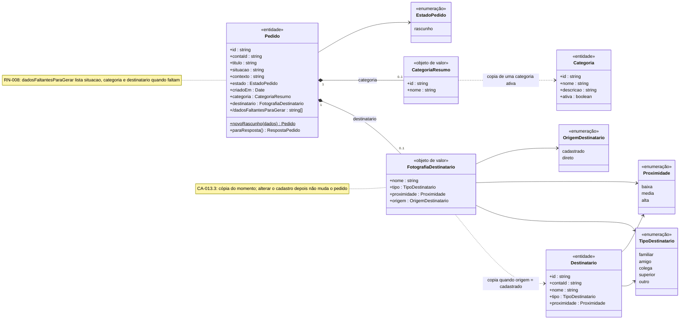
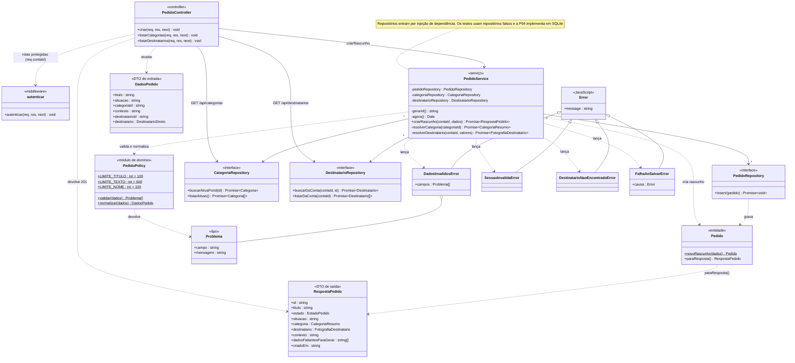
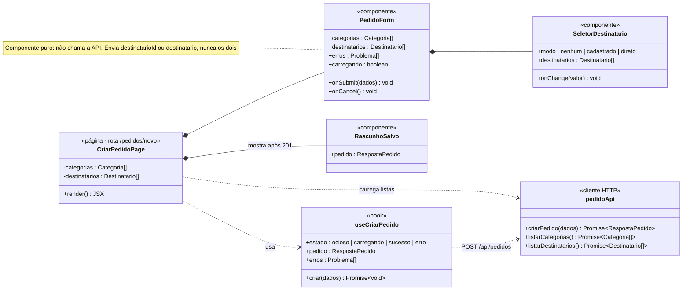

# UC-013 — Criar pedido de desculpa: diagrama de classes

Este documento mostra a **estrutura** do UC-013, ou seja, as classes, as responsabilidades e os relacionamentos. O comportamento está no diagrama de sequência (`Atividade 4/Diagramas Sequencias/UC-013.svg`), e as regras e o contrato da API estão em [`uc-013-especificacao.md`](uc-013-especificacao.md).

O modelo foi dividido em três visões para ficar legível:

1. **Domínio**: o pedido, a fotografia do destinatário e os dados de referência.
2. **Back-end**: o controller, o serviço, a política, os repositórios e os erros.
3. **Front-end**: a página, os componentes, o hook e o cliente da API.

As classes do domínio e do serviço já estão implementadas (P01 a P03). As demais seguem o plano das tasks P04 a P11 e podem ser ajustadas quando forem implementadas. A seção 4 mostra a situação de cada uma.

## 1. Domínio

**Por que a fotografia é composição e não associação:** o pedido guarda uma **cópia** dos dados do destinatário e da categoria (CA-013.3). Por isso o `Pedido` não referencia um `Destinatario` nem uma `Categoria`. Ele contém um objeto de valor que nasce e morre com ele. A ligação com o cadastro é só de origem (`..>` "copia"). Um destinatário informado direto (A3) gera a fotografia com `origem = direto` e não cria nenhum `Destinatario` (CA-013.2).

**Por que não há classe `Conta`:** a conta pertence ao UC-002 (login), que ainda não existe. O `contaId` vem da sessão provisória (`req.contaId`) e garante a propriedade dos dados (RN-003): o pedido e o destinatário pertencem a uma conta.

## 2. Back-end (camadas)

**Dependências entre camadas** (seção 6 da especificação): `controller → service → domínio` e `service → repository`. O domínio (`Pedido`, `PedidoPolicy`, erros) não importa Express nem SQLite. Por isso o `PedidoService` depende das **interfaces** dos repositórios, e não das implementações.

**Como os erros viram respostas HTTP:** o `PedidoService` lança os erros do domínio, e o controller (com o middleware de erro central) converte cada um em uma resposta do contrato.

| Erro | Resposta | Fluxo do UC |
|---|---|---|
| `DadosInvalidosError` | 400 `DADOS_INVALIDOS`, com `campos` | A5 e categoria inativa |
| `SessaoInvalidaError` | 401 `SESSAO_INVALIDA` | E1 (sessão) |
| `DestinatarioNaoEncontradoError` | 404 `DESTINATARIO_NAO_ENCONTRADO` | E1 (destinatário de outra conta ou inexistente) |
| `FalhaAoSalvarError` | 500 `FALHA_AO_SALVAR` | E2 |

`DestinatarioDireto` (usado em `DadosPedido`) tem `nome`, `tipo` e `proximidade`. Ele é o mesmo formato da `FotografiaDestinatario`, mas sem `origem`, que é definida pelo serviço.

## 3. Front-end

O `pedidoApi` conversa com o `PedidoController` do back-end por HTTP (`Authorization: Bearer dev:<contaId>`). Os tipos `Categoria`, `Destinatario`, `Problema` e `RespostaPedido` são os mesmos do contrato da API.

## 4. Rastreabilidade

Cada classe corresponde a uma linha de vida do diagrama de sequência do UC-013 e a uma task do plano ([`plano-uc-013.md`](plano-uc-013.md)).

| Classe | Linha de vida no diagrama de sequência | Task | Situação | Arquivo |
|---|---|---|---|---|
| `CriarPedidoPage`, `PedidoForm`, `SeletorDestinatario`, `RascunhoSalvo` | Interface | P07, P08, P11 | Planejada | `frontend/src/features/criar-pedido/components` e `pages` |
| `useCriarPedido`, `pedidoApi` | Interface | P10 | Planejada | `frontend/src/features/criar-pedido/api` |
| `autenticar` | Serviço de pedidos (autorizar sessão) | P05 | Planejada | `backend/src/compartilhado/auth` |
| `PedidoController` | Serviço de pedidos (entrada) | P05, P06 | Planejada | `backend/src/pedidos/controller` |
| `PedidoService` | Serviço de pedidos | P02, P03 | **Implementada** | `backend/src/pedidos/service/PedidoService.js` |
| `PedidoPolicy` | Serviço de pedidos (validar título e dados) | P01 | **Implementada** | `backend/src/pedidos/domain/PedidoPolicy.js` |
| `Pedido`, `FotografiaDestinatario`, `CategoriaResumo` | Pedido em rascunho | P01 | **Implementada** | `backend/src/pedidos/domain/Pedido.js` |
| Enumerações e limites | Pedido em rascunho | P01 | **Implementada** | `backend/src/pedidos/domain/constantes.js` |
| Erros do domínio | Serviço de pedidos (recusas) | P01 | **Implementada** | `backend/src/pedidos/domain/erros.js` |
| `PedidoRepository`, `CategoriaRepository`, `DestinatarioRepository` | Persistência | P04 | Interface definida no serviço, SQLite planejado | `backend/src/pedidos/repository` |
| `Categoria`, `Destinatario` | Persistência | P04 | Planejada (tabelas e seed) | `backend/src/pedidos/repository` |

| Requisito ou regra | Onde aparece no modelo |
|---|---|
| RF-013 | `PedidoService.criarRascunho` |
| RN-003 (propriedade) | `contaId` em `Pedido` e `Destinatario`; `DestinatarioRepository.buscarDaConta(contaId, id)` |
| RN-007 (destinatário válido) | `PedidoPolicy.validar`, `TipoDestinatario`, `Proximidade` |
| RN-008 (dados para gerar) | `Pedido.dadosFaltantesParaGerar`, `EstadoPedido` |
| RNF-003 (usabilidade) | `Problema` (mensagem por campo) e `PedidoForm` |
