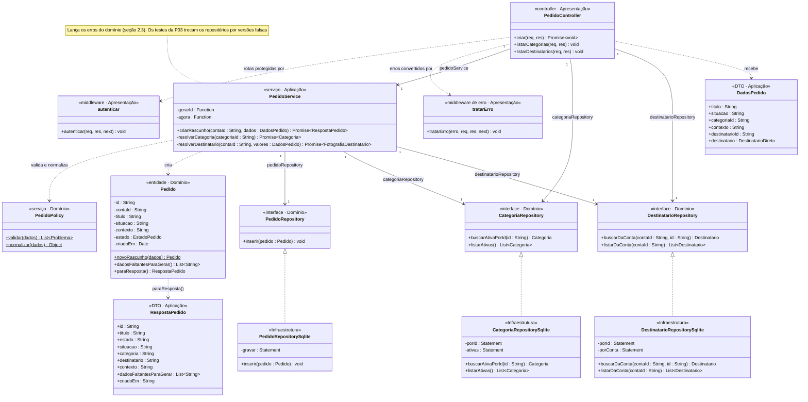
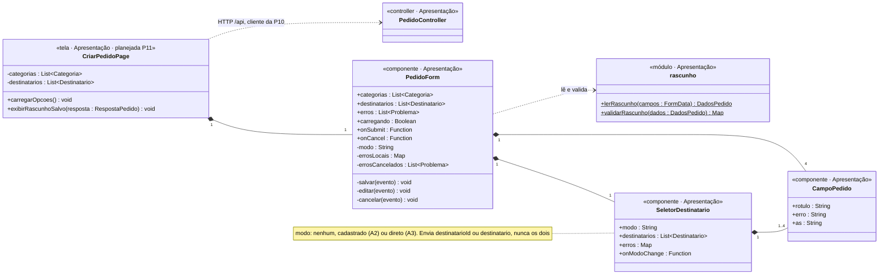
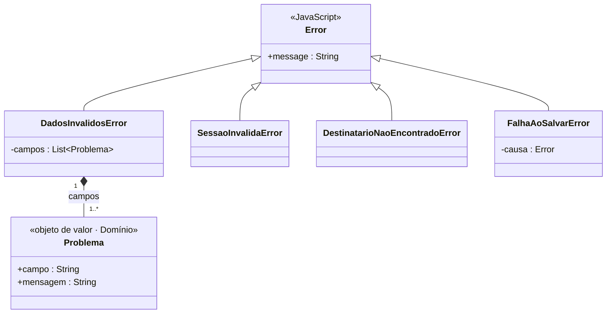
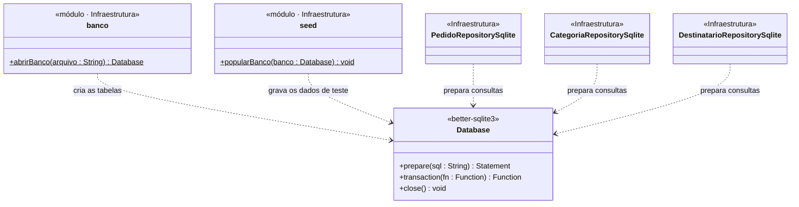

# UC-013 — Criar pedido de desculpa: diagrama de classes

Este documento mostra a **estrutura estática** do UC-013: as classes, seus atributos e operações, a visibilidade e os relacionamentos com multiplicidade. O comportamento está no diagrama de sequência (`Atividade 4/Diagramas Sequencias/UC-013.svg`), e as regras e o contrato da API estão em [`uc-013-especificacao.md`](uc-013-especificacao.md).

São dois tipos de diagrama, com propósitos diferentes:

1. **Diagrama de classes de domínio (seção 1):** só os conceitos do negócio (conta, pedido, destinatário e categoria) e como eles se relacionam. Não tem tela, controller nem banco.
2. **Diagrama de classes de projeto (seção 2):** as classes que implementam o caso de uso, nas camadas **Apresentação**, **Aplicação**, **Domínio** e **Infraestrutura**. Para ficar legível, ele foi dividido em três partes: back-end, front-end e erros. A camada de cada classe aparece no estereótipo, por exemplo `«controller · Apresentação»`. A seção 2.4 mostra o banco de dados e como as classes viram tabelas.

O documento reflete o código integrado na `feature/uc-013-criar-pedido-desculpa` até a P09. Só a página e o cliente da API (P10 e P11) aparecem como planejados.

Convenções usadas:
- **Visibilidade:** `-` é privado e `+` é público. Os atributos das entidades são privados e só mudam pelas operações da própria classe (encapsulamento).
- **Atributo ou associação, nunca os dois:** quando uma classe se liga a outra (por exemplo, `Pedido` → `Categoria`), a ligação aparece só como associação com multiplicidade, e não se repete como atributo.
- **Operações sublinhadas** são estáticas (de classe).
- **Estereótipos** como `«entidade»`, `«objeto de valor»`, `«interface»` e `«enumeração»` indicam o papel de cada classe.

## 1. Diagrama de classes de domínio


**Leitura do diagrama:**

- **`Pedido` → `Conta` e `Destinatario` → `Conta` (1):** todo pedido e todo destinatário pertencem a exatamente uma conta (RN-003, propriedade dos dados). A `Conta` é do UC-002 (login), que ainda não existe. Por isso ela aparece só com o `id`, que hoje vem da sessão provisória.
- **`Pedido` → `Categoria` (0..1):** o rascunho pode ser salvo sem categoria (A1). Se tiver uma, ela precisa estar ativa. Uma categoria classifica muitos pedidos (0..\*).
- **`Pedido` ◆— `FotografiaDestinatario` (composição, 0..1):** o pedido **contém** uma cópia dos dados do destinatário. A fotografia não existe sem o pedido e é destruída com ele. Por isso é composição (diamante preenchido), e não associação com `Destinatario`.
- **`FotografiaDestinatario` ⇢ `Destinatario` (dependência "copiada de"):** só existe quando o usuário escolhe um destinatário cadastrado (A2, `origem = CADASTRADO`). Quando ele informa o destinatário direto (A3, `origem = DIRETO`), não há `Destinatario` envolvido e nenhum é criado (CA-013.2).
- **As enumerações** aparecem como tipo dos atributos e não precisam de linhas.

## 2. Diagrama de classes de projeto

### 2.1 Back-end



Os tipos `Categoria`, `Destinatario`, `FotografiaDestinatario` e `EstadoPedido` estão detalhados no diagrama de domínio (seção 1). `DestinatarioDireto` é o objeto com `nome`, `tipo` e `proximidade` que o usuário informa no caso A3.

**Quem monta as peças:** a função `criarApp()` (`backend/src/app.js`) abre o banco, cria os três repositórios SQLite, entrega esses repositórios ao `PedidoService` e ao `PedidoController` (injeção de dependência) e registra as rotas: `POST /api/pedidos`, `GET /api/categorias` e `GET /api/destinatarios`, todas protegidas por `autenticar`, com `tratarErro` no fim. Os testes chamam `criarApp({ banco })` com um banco em memória.

**Diferença entre contrato e implementação do repositório:** as interfaces `PedidoRepository`, `CategoriaRepository` e `DestinatarioRepository` ficam no **Domínio**, porque descrevem o que o caso de uso precisa. Como JavaScript não tem a palavra-chave `interface`, esse contrato está documentado no comentário do `PedidoService.js`. As classes `...Sqlite` ficam na **Infraestrutura** e **realizam** essas interfaces (seta tracejada com triângulo vazio). O `PedidoService` conhece só as interfaces, então os testes usam repositórios falsos (P03) e o SQLite pode ser trocado sem mexer no serviço.

**Por que aqui o `Pedido` tem `contaId`:** a `Conta` ainda não existe como classe, porque o login é do UC-002. No código, o dono do pedido é o `contaId` que o middleware `autenticar` coloca na requisição. No diagrama de domínio, essa mesma ligação aparece como a associação `Pedido → Conta`.

**Funções como classes:** `autenticar`, `tratarErro`, `banco` e `seed` são funções ou módulos no código, e não classes. Aparecem no diagrama com estereótipo porque têm responsabilidade própria no projeto.

### 2.2 Front-end



O `PedidoForm` é um componente puro: recebe os dados pelas propriedades (`+`) e devolve o resultado pelos callbacks `onSubmit` e `onCancel`, sem chamar a API. O estado interno (`-`) guarda só o modo do destinatário e os erros. Os valores dos campos são lidos no envio, com `FormData`, pela função `lerRascunho`. O `CampoPedido` junta rótulo, controle e mensagem de erro com `aria-invalid` e `aria-describedby` (RNF-003).

A `CriarPedidoPage` e o cliente da API (`pedidoApi` e `useCriarPedido`) são as tasks P11 e P10, ainda não implementadas.

### 2.3 Erros do domínio



O `PedidoService` lança esses erros, e o `autenticar` lança o `SessaoInvalidaError`. O middleware `tratarErro` converte cada um na resposta do contrato (tabela da seção 3).

### 2.4 Banco de dados



Os repositórios aparecem aqui sem detalhes porque estão descritos na seção 2.1. O arquivo do banco fica em `backend/vazaapp.sqlite`, fora do Git; os testes usam um banco em memória (`:memory:`).

O SQLite tem três tabelas, criadas por `abrirBanco` (`backend/src/pedidos/repository/banco.js`):

| Tabela | Colunas | Classe do modelo |
|---|---|---|
| `pedidos` | `id`, `conta_id`, `titulo`, `estado`, `situacao`, `contexto`, `categoria_id` (chave estrangeira para `categorias`), `categoria_nome`, `destinatario_nome`, `destinatario_tipo`, `destinatario_proximidade`, `destinatario_origem`, `criado_em` | `Pedido`, com a `FotografiaDestinatario` gravada nas colunas `destinatario_*` |
| `categorias` | `id`, `nome`, `descricao`, `ativa` | `Categoria` |
| `destinatarios` | `id`, `conta_id`, `nome`, `tipo`, `proximidade` | `Destinatario` |

A composição `Pedido ◆— FotografiaDestinatario` vira colunas da própria tabela `pedidos`, e não uma tabela separada: a fotografia não tem identidade nem existe sem o pedido. Por isso alterar um registro de `destinatarios` não muda os pedidos já gravados (CA-013.3).

## 3. Responsabilidades das classes

| Classe | Camada | Responsabilidade | Depende de | RN, RF e UC |
|---|---|---|---|---|
| `CriarPedidoPage` (planejada, P11) | Apresentação | Abrir a tela, carregar categorias e destinatários e mostrar o rascunho salvo com os dados que faltam (passo 6) | `PedidoForm`, cliente da API (P10) | RF-013, UC-013 |
| `PedidoForm` | Apresentação | Montar o formulário, validar antes de enviar (título vazio não envia, A5), entregar os dados pelo `onSubmit` e limpar tudo ao cancelar (A6) | `SeletorDestinatario`, `CampoPedido`, `rascunho` | RN-008, RNF-003 |
| `SeletorDestinatario` | Apresentação | Mostrar os modos nenhum, cadastrado (A2) e direto (A3) e os campos de cada modo | `CampoPedido` | RN-007 |
| `CampoPedido` | Apresentação | Juntar rótulo, controle e mensagem de erro acessível | — | RNF-003 |
| `rascunho` (`lerRascunho`, `validarRascunho`) | Apresentação | Ler os campos e montar `destinatarioId` **ou** `destinatario`, nunca os dois; validar no cliente | — | RN-007, RN-008 |
| `autenticar` | Apresentação | Validar a sessão provisória (`Bearer dev:<contaId>`, só fora de produção) e preencher `req.contaId` | — | RN-003, E1 |
| `PedidoController` | Apresentação | Receber as requisições, chamar o serviço para gravar e os repositórios para as listas de apoio | `PedidoService`, repositórios (só leitura) | RF-013 |
| `tratarErro` | Apresentação | Converter cada erro na resposta HTTP do contrato, sem expor detalhes internos | Erros do domínio | RNF-003, E1, E2 |
| `PedidoService` | Aplicação | Coordenar o caso de uso: validar, resolver categoria e destinatário, criar o `Pedido`, gravar e devolver a resposta | `PedidoPolicy`, `Pedido`, interfaces dos repositórios | RF-013, RN-003, RN-007, UC-013 |
| `Pedido` | Domínio | Representar o pedido, nascer como rascunho e saber quais dados faltam para gerar uma sugestão | `FotografiaDestinatario`, `Categoria` | RN-008, CA-013.1 |
| `FotografiaDestinatario` | Domínio | Guardar a cópia de nome, tipo, proximidade e origem do destinatário no momento da criação | — | RN-007, CA-013.2, CA-013.3 |
| `PedidoPolicy` | Domínio | Validar e normalizar os dados de entrada. Devolve a lista de problemas por campo, sem lançar exceção | `Problema` | RN-007, RN-008 |
| `PedidoRepository`, `CategoriaRepository`, `DestinatarioRepository` | Domínio (contrato) | Definir as operações de gravação e consulta que o serviço usa | — | RN-003 |
| `...RepositorySqlite` | Infraestrutura | Implementar os contratos com consultas preparadas no SQLite. `buscarDaConta` e `listarDaConta` filtram por `conta_id` | `Database` | RN-003 |
| `banco`, `seed` | Infraestrutura | Criar as tabelas e gravar os dados de desenvolvimento (`npm run seed`) | `Database` | — |

**Como os erros viram respostas HTTP** (conversão feita pelo `tratarErro`):

| Erro | Resposta | Fluxo do UC |
|---|---|---|
| `DadosInvalidosError` | 400 `DADOS_INVALIDOS`, com a lista `campos` | A5 e categoria inativa |
| JSON inválido ou corpo grande demais | 400 `DADOS_INVALIDOS`, com `campo: "corpo"` | A5 |
| `SessaoInvalidaError` | 401 `SESSAO_INVALIDA` | E1 (sessão inválida) |
| `DestinatarioNaoEncontradoError` | 404 `DESTINATARIO_NAO_ENCONTRADO` | E1 (destinatário de outra conta ou inexistente) |
| `FalhaAoSalvarError` ou outro erro no `POST` | 500 `FALHA_AO_SALVAR` | E2 |
| Qualquer erro nos `GET` de apoio | 500 `FALHA_AO_CONSULTAR` | — |

## 4. Regras de dependência

- **Apresentação → Aplicação → Domínio ← Infraestrutura.** A Infraestrutura depende do Domínio porque implementa as interfaces dele, e não o contrário.
- O **Domínio** não importa Express, React nem SQLite.
- O `PedidoController` lê categorias e destinatários direto dos repositórios. São consultas sem regra de negócio, e a lista da Atividade 6 (exercício 12b) considera esse atalho aceitável para leitura. A gravação do pedido passa sempre pelo `PedidoService`.
- Só a função `criarApp()` conhece as classes concretas `...Sqlite`. O resto do back-end recebe as dependências prontas.

## 5. Rastreabilidade

```text
RN-003, RN-007, RN-008
  → RF-013 (Criar pedido de desculpa)
    → UC-013 (fluxo principal e A1 a A6, E1 e E2)
      → Diagrama de sequência UC-013
        → Classes e operações (tabela abaixo)
          → Diretórios: backend/src/compartilhado/auth
                        backend/src/pedidos/{domain, service, repository, controller}
                        frontend/src/features/criar-pedido/{components, pages, api}
```

| Linha de vida no diagrama de sequência | Classes | Task | Situação | Arquivo |
|---|---|---|---|---|
| Interface | `PedidoForm`, `CampoPedido` | P07 | **Implementada** | `frontend/src/features/criar-pedido/components` |
| Interface | `SeletorDestinatario`, `rascunho` | P08 | **Implementada** | `frontend/src/features/criar-pedido/components` e `rascunho.js` |
| Interface | `CriarPedidoPage`, cliente da API | P10, P11 | Planejada | `frontend/src/features/criar-pedido/pages` e `api` |
| Serviço de pedidos (sessão) | `autenticar` | P05 | **Implementada** | `backend/src/compartilhado/auth/autenticar.js` |
| Serviço de pedidos (entrada) | `PedidoController`, `tratarErro` | P05, P06 | **Implementada** | `backend/src/pedidos/controller` |
| Serviço de pedidos | `PedidoService`, `DadosPedido`, `RespostaPedido` | P02, P03 | **Implementada** | `backend/src/pedidos/service/PedidoService.js` |
| Serviço de pedidos (validação) | `PedidoPolicy`, `Problema` | P01 | **Implementada** | `backend/src/pedidos/domain/PedidoPolicy.js` |
| Pedido em rascunho | `Pedido`, `FotografiaDestinatario`, enumerações | P01 | **Implementada** | `backend/src/pedidos/domain/Pedido.js` e `constantes.js` |
| Serviço de pedidos (recusas) | Erros do domínio | P01 | **Implementada** | `backend/src/pedidos/domain/erros.js` |
| Persistência | Interfaces dos repositórios | P02 | **Implementada** (contrato no comentário do serviço) | `backend/src/pedidos/service/PedidoService.js` |
| Persistência | `...RepositorySqlite`, `banco`, `seed`, tabelas `categorias` e `destinatarios` | P04 | **Implementada** | `backend/src/pedidos/repository` |

Os nomes das classes planejadas (P10 e P11) são uma proposta. Se a implementação usar outros nomes, este documento deve ser atualizado no mesmo PR.

## 6. Pontos de atenção do projeto

- **`Pedido.paraResposta()` coloca o formato da resposta da API dentro da entidade.** Isso cria uma dependência do Domínio para um DTO da Aplicação (`RespostaPedido`), o sentido contrário ao da seção 4. Uma melhoria simples é mover essa conversão para o `PedidoService`, deixando o `Pedido` só com as regras.
- **`Categoria` e `Destinatario` são entidades sem comportamento** nesta entrega, porque só são lidas (os cadastros são do UC-009 e do UC-027). Quando esses casos de uso existirem, regras como "só categoria ativa classifica pedido" podem passar para a própria `Categoria`.
- **O `tratarErro` escolhe a resposta 500 pelo método HTTP** (`GET` → `FALHA_AO_CONSULTAR`, demais → `FALHA_AO_SALVAR`). Funciona com as três rotas atuais, mas uma rota nova que grave dados por `GET`, ou que só consulte por `POST`, receberia a mensagem errada.
