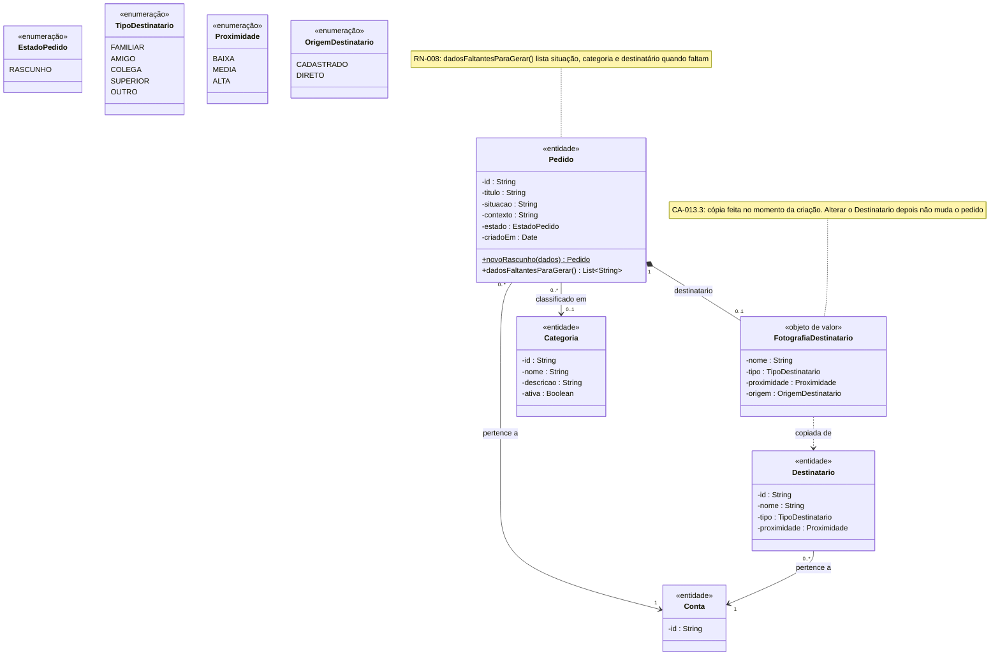
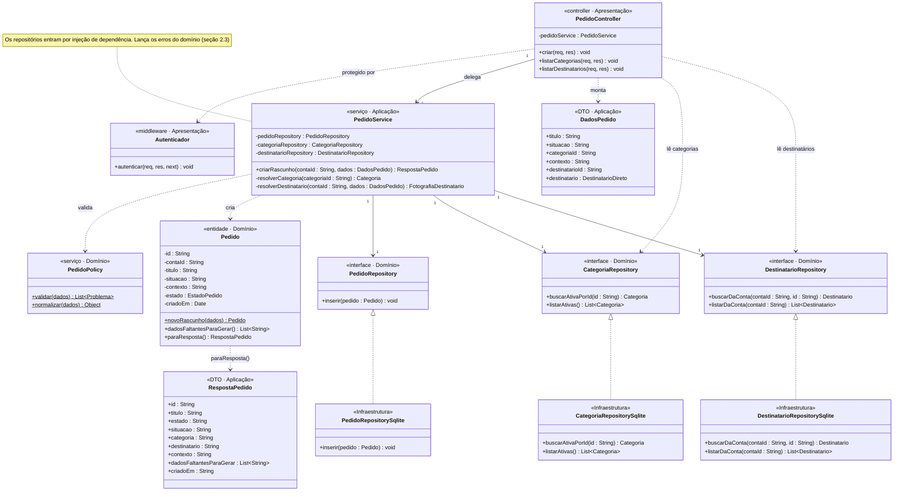
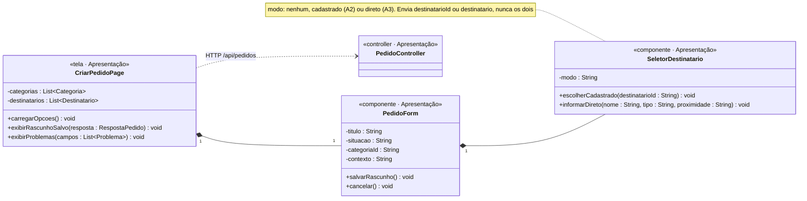
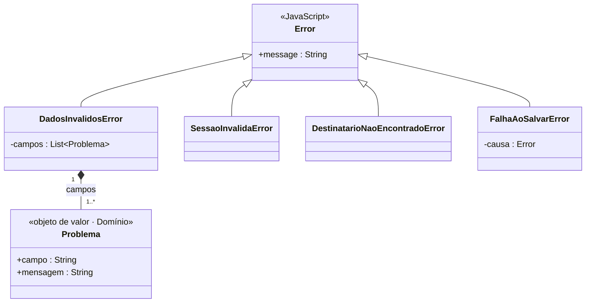

# UC-013 — Criar pedido de desculpa: diagrama de classes

Este documento mostra a **estrutura estática** do UC-013: as classes, seus atributos e operações, a visibilidade e os relacionamentos com multiplicidade. O comportamento está no diagrama de sequência (`Atividade 4/Diagramas Sequencias/UC-013.svg`), e as regras e o contrato da API estão em [`uc-013-especificacao.md`](uc-013-especificacao.md).

São dois tipos de diagrama, com propósitos diferentes:

1. **Diagrama de classes de domínio (seção 1):** só os conceitos do negócio (conta, pedido, destinatário e categoria) e como eles se relacionam. Não tem tela, controller nem banco.
2. **Diagrama de classes de projeto (seção 2):** as classes que implementam o caso de uso, nas camadas **Apresentação**, **Aplicação**, **Domínio** e **Infraestrutura**. Para ficar legível, ele foi dividido em três partes: back-end, front-end e erros. A camada de cada classe aparece no estereótipo, por exemplo `«controller · Apresentação»`.

Convenções usadas:
- **Visibilidade:** `-` é privado e `+` é público. Os atributos das entidades são privados e só mudam pelas operações da própria classe (encapsulamento).
- **Atributo ou associação, nunca os dois:** quando uma classe se liga a outra (por exemplo, `Pedido` → `Categoria`), a ligação aparece só como associação com multiplicidade, e não se repete como atributo.
- **Operações sublinhadas** são estáticas (de classe).
- **Estereótipos** como `«entidade»`, `«objeto de valor»`, `«interface»` e `«enumeração»` indicam o papel de cada classe.

## 1. Diagrama de classes de domínio



**Leitura do diagrama:**

- **`Pedido` → `Conta` e `Destinatario` → `Conta` (1):** todo pedido e todo destinatário pertencem a exatamente uma conta (RN-003, propriedade dos dados). A `Conta` é do UC-002 (login), que ainda não existe. Por isso ela aparece só com o `id`, que hoje vem da sessão provisória.
- **`Pedido` → `Categoria` (0..1):** o rascunho pode ser salvo sem categoria (A1). Se tiver uma, ela precisa estar ativa. Uma categoria classifica muitos pedidos (0..\*).
- **`Pedido` ◆— `FotografiaDestinatario` (composição, 0..1):** o pedido **contém** uma cópia dos dados do destinatário. A fotografia não existe sem o pedido e é destruída com ele. Por isso é composição (diamante preenchido), e não associação com `Destinatario`.
- **`FotografiaDestinatario` ⇢ `Destinatario` (dependência "copiada de"):** só existe quando o usuário escolhe um destinatário cadastrado (A2, `origem = CADASTRADO`). Quando ele informa o destinatário direto (A3, `origem = DIRETO`), não há `Destinatario` envolvido e nenhum é criado (CA-013.2).
- **As enumerações** aparecem como tipo dos atributos e não precisam de linhas.

## 2. Diagrama de classes de projeto

### 2.1 Back-end



Os tipos `Categoria`, `Destinatario`, `FotografiaDestinatario` e `EstadoPedido` estão detalhados no diagrama de domínio (seção 1). `DestinatarioDireto` é o objeto com `nome`, `tipo` e `proximidade` que o usuário informa no caso A3.

**Diferença entre contrato e implementação do repositório:** as interfaces `PedidoRepository`, `CategoriaRepository` e `DestinatarioRepository` ficam no **Domínio**, porque descrevem o que o caso de uso precisa. As classes `...Sqlite` ficam na **Infraestrutura** e **realizam** essas interfaces (seta tracejada com triângulo vazio). O `PedidoService` conhece só as interfaces, então os testes usam repositórios falsos (P03) e o SQLite pode ser trocado sem mexer no serviço.

**Por que aqui o `Pedido` tem `contaId`:** a `Conta` ainda não existe como classe, porque o login é do UC-002. No código, o dono do pedido é o `contaId` que o `Autenticador` coloca na requisição. No diagrama de domínio, essa mesma ligação aparece como a associação `Pedido → Conta`.

### 2.2 Front-end



A tela conversa com o back-end só por HTTP: `POST /api/pedidos`, `GET /api/categorias` e `GET /api/destinatarios`. O `PedidoController` aparece aqui sem detalhes porque está descrito na seção 2.1.

### 2.3 Erros do domínio



O `PedidoService` lança esses erros, e o `PedidoController` converte cada um na resposta do contrato. A tabela da seção 3 mostra essa conversão.

## 3. Responsabilidades das classes

| Classe | Camada | Responsabilidade | Depende de | RN, RF e UC |
|---|---|---|---|---|
| `CriarPedidoPage` | Apresentação | Abrir a tela, carregar categorias e destinatários e mostrar o rascunho salvo com os dados que faltam (passo 6) ou os problemas de cada campo (A5) | `PedidoController` (HTTP) | RF-013, RNF-003, UC-013 |
| `PedidoForm` | Apresentação | Capturar título, situação, categoria e contexto. Não envia se o título estiver vazio (A5). Cancelar encerra sem chamar a API (A6) | `SeletorDestinatario` | RN-008, RNF-003 |
| `SeletorDestinatario` | Apresentação | Escolher entre nenhum destinatário, um cadastrado (A2) ou um informado direto (A3). Envia `destinatarioId` **ou** `destinatario`, nunca os dois | — | RN-007 |
| `Autenticador` | Apresentação | Validar a sessão provisória e preencher `req.contaId`. Sem sessão válida, responde 401 (E1) | — | RN-003 |
| `PedidoController` | Apresentação | Receber a requisição HTTP, chamar o serviço e converter o resultado ou o erro na resposta do contrato | `PedidoService`, repositórios (só leitura) | RF-013 |
| `PedidoService` | Aplicação | Coordenar o caso de uso: validar, resolver categoria e destinatário, criar o `Pedido`, gravar e devolver a resposta | `PedidoPolicy`, `Pedido`, interfaces dos repositórios | RF-013, RN-003, RN-007, UC-013 |
| `Pedido` | Domínio | Representar o pedido, nascer como rascunho e saber quais dados faltam para gerar uma sugestão | `FotografiaDestinatario`, `Categoria` | RN-008, CA-013.1 |
| `FotografiaDestinatario` | Domínio | Guardar a cópia de nome, tipo, proximidade e origem do destinatário no momento da criação | — | RN-007, CA-013.2, CA-013.3 |
| `PedidoPolicy` | Domínio | Validar e normalizar os dados de entrada. Devolve a lista de problemas por campo, sem lançar exceção | `Problema` | RN-007, RN-008 |
| `PedidoRepository`, `CategoriaRepository`, `DestinatarioRepository` | Domínio (contrato) | Definir as operações de gravação e consulta que o serviço usa. `buscarDaConta` só devolve destinatários da conta | — | RN-003 |
| `...RepositorySqlite` | Infraestrutura | Implementar os contratos com SQLite | Banco SQLite | — |

**Como os erros do domínio viram respostas HTTP** (o `PedidoController` faz a conversão):

| Erro | Resposta | Fluxo do UC |
|---|---|---|
| `DadosInvalidosError` | 400 `DADOS_INVALIDOS`, com a lista `campos` | A5 e categoria inativa |
| `SessaoInvalidaError` | 401 `SESSAO_INVALIDA` | E1 (sessão inválida) |
| `DestinatarioNaoEncontradoError` | 404 `DESTINATARIO_NAO_ENCONTRADO` | E1 (destinatário de outra conta ou inexistente) |
| `FalhaAoSalvarError` | 500 `FALHA_AO_SALVAR` | E2 |

## 4. Regras de dependência

- **Apresentação → Aplicação → Domínio ← Infraestrutura.** A Infraestrutura depende do Domínio porque implementa as interfaces dele, e não o contrário.
- O **Domínio** não importa Express, React nem SQLite.
- O `PedidoController` lê categorias e destinatários direto dos repositórios. São consultas sem regra de negócio, e a lista da Atividade 6 (exercício 12b) considera esse atalho aceitável para leitura. A gravação do pedido passa sempre pelo `PedidoService`.

## 5. Rastreabilidade

```text
RN-003, RN-007, RN-008
  → RF-013 (Criar pedido de desculpa)
    → UC-013 (fluxo principal e A1 a A6, E1 e E2)
      → Diagrama de sequência UC-013
        → Classes e operações (tabela abaixo)
          → Diretórios: backend/src/pedidos/{domain, service, repository, controller}
                        frontend/src/features/criar-pedido/{components, pages, api}
```

| Linha de vida no diagrama de sequência | Classes | Task | Situação | Arquivo |
|---|---|---|---|---|
| Interface | `CriarPedidoPage`, `PedidoForm`, `SeletorDestinatario` | P07, P08, P11 | Planejada | `frontend/src/features/criar-pedido` |
| Serviço de pedidos (sessão) | `Autenticador` | P05 | Planejada | `backend/src/compartilhado/auth` |
| Serviço de pedidos (entrada) | `PedidoController` | P05, P06 | Planejada | `backend/src/pedidos/controller` |
| Serviço de pedidos | `PedidoService`, `DadosPedido`, `RespostaPedido` | P02, P03 | **Implementada** | `backend/src/pedidos/service/PedidoService.js` |
| Serviço de pedidos (validação) | `PedidoPolicy`, `Problema` | P01 | **Implementada** | `backend/src/pedidos/domain/PedidoPolicy.js` |
| Pedido em rascunho | `Pedido`, `FotografiaDestinatario`, enumerações | P01 | **Implementada** | `backend/src/pedidos/domain/Pedido.js` e `constantes.js` |
| Serviço de pedidos (recusas) | Erros do domínio | P01 | **Implementada** | `backend/src/pedidos/domain/erros.js` |
| Persistência | Interfaces dos repositórios | P02 | **Definidas** (contrato no serviço) | `backend/src/pedidos/service/PedidoService.js` |
| Persistência | `...RepositorySqlite`, `Categoria`, `Destinatario` | P04 | Planejada | `backend/src/pedidos/repository` |

Os nomes das classes planejadas (P04 a P11) são uma proposta. Se a implementação usar outros nomes, este documento deve ser atualizado no mesmo PR.

## 6. Pontos de atenção do projeto

- **`Pedido.paraResposta()` coloca o formato da resposta da API dentro da entidade.** Isso cria uma dependência do Domínio para um DTO da Aplicação (`RespostaPedido`), o sentido contrário ao da seção 4. Uma melhoria simples é mover essa conversão para o `PedidoService`, deixando o `Pedido` só com as regras.
- **`Categoria` e `Destinatario` são entidades sem comportamento** nesta entrega, porque só são lidas (os cadastros são do UC-009 e do UC-027). Quando esses casos de uso existirem, regras como "só categoria ativa classifica pedido" podem passar para a própria `Categoria`.
